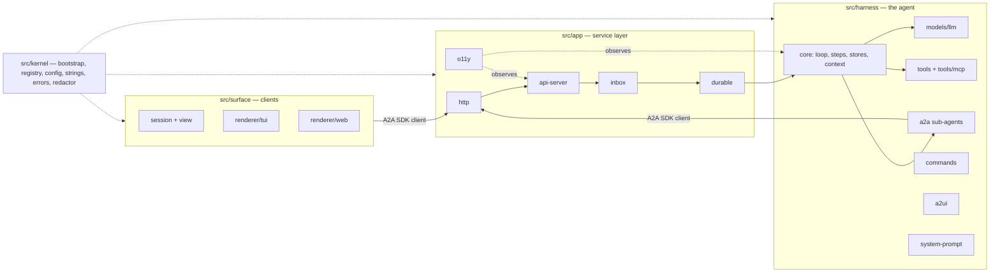
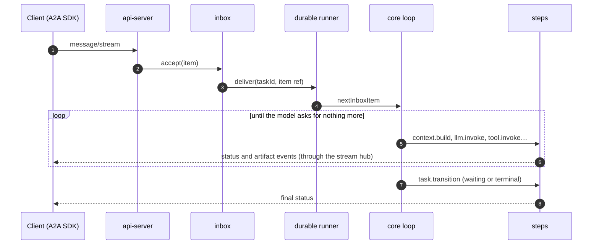

# Architecture — yaah

yaah is an agent harness for customer-facing workflows: it holds a conversation as a
long-lived **task**, calls a model and tools on the task's behalf, and survives a restart
in the middle of either. It is not a coding harness and has no shell.

Everything is a [cordis](https://github.com/cordiverse/cordis) plugin. A build is a YAML
**composition** naming which plugins run; an operator replaces any of them by id from
`config.toml`. The full design, with its reasoning, is
[`docs/specs/issue-3/design.md`](../specs/issue-3/design.md); the decisions are in
[`docs/decisions/`](../decisions/decisions.md).

## The source tree

| Directory          | Holds                                                                                                                                                                                |
| ------------------ | ------------------------------------------------------------------------------------------------------------------------------------------------------------------------------------ |
| `src/kernel`       | What every layer shares: the composition bootstrap, the entity registry, configuration, user-visible strings, errors, the redactor. The only place that knows cordis internals.      |
| `src/harness`      | The agent: the core loop and its steps, the stores, context building and compaction, and the entity kinds a plugin can add — models, tools, sub-agents, commands, prompts.           |
| `src/app`          | The service around the agent: the HTTP listener, the A2A request handling, the inbox, durable execution, observability.                                                              |
| `src/surface`      | Clients. A `HarnessSession` talks A2A through the official SDK client and folds what it receives into a `TaskView`; a renderer draws that view. Nothing here imports from `src/app`. |
| `src/cli`          | The `yaah` command. It calls the same `loadConfig` and `createHarness` the package exports.                                                                                          |
| `src/compositions` | The shipped builds (`cli.yml`, `server.yml`) and the layers they share.                                                                                                              |
| `src/testing`      | Contract suites an implementation of a yaah interface must pass, and a scripted model.                                                                                               |
| `specs/`           | Generated, checked-in contracts: the configuration schema, the A2A extension schemas, the package's export list. A contract test fails when source and file differ.                  |

## One request

An item is stored before it is delivered, so a crash between the two loses nothing: on
restart every open task gets its run back and pending items are delivered again.

## The loop and its steps

`runTask` (`src/harness/core/loop.ts`) is a pure function: it decides what happens next
and asks a `StepRunner` to do it. The six steps — `conversation.accept`, `context.build`,
`context.compact`, `llm.invoke`, `tool.invoke`, `task.transition` — are the only code
with effects (`src/harness/core/steps.ts`). Each writes under the step key it is given
and replaces what that key wrote before, so performing a step twice leaves the stores as
performing it once ([decision-002](../decisions/decision-002.md)).

Two runners perform steps:

| `durable.mode`      | Runner                                    | Survives a restart by                                  |
| ------------------- | ----------------------------------------- | ------------------------------------------------------ |
| `none`              | `DirectRunner`, in this process           | replaying a journal of completed steps from SQLite     |
| `temporal-embedded` | a Temporal workflow; steps are activities | Temporal's history (dev server started by the harness) |
| `temporal-remote`   | the same workflow                         | Temporal's history (a cluster or Temporal Cloud)       |

A step that was in flight and is not safe to repeat is not repeated: its outcome is
recorded as unknown and reported to the model. Temporal history holds references, never
conversation content ([decision-005](../decisions/decision-005.md)).

## Tasks over A2A

A long-running task waits between turns in `INPUT_REQUIRED` with a sub-state in metadata,
and ends when the client sends `{ action: "complete" }` or cancels
([decision-003](../decisions/decision-003.md)). yaah's additions to A2A are extensions
under `https://github.com/MadaraUchiha-314/yaah/extensions/<name>/v1`, each with a JSON
Schema in `specs/a2a-extensions/`: `task-lifecycle`, `task-model`, `inbox-events`,
`commands`, `durable-execution`, `activity`.

## Observability

The `o11y` plugin only listens. Every step passes through step middleware
(`taskRuntime.addStepMiddleware`), where the plugin writes one JSON log record and opens
one OpenTelemetry span, named by the GenAI conventions (`chat <model>`,
`execute_tool <name>`, `invoke_agent <id>`). A request span continues the caller's W3C
`traceparent`; the steps of the task it reaches are its children; calls to other agents
and MCP servers carry it on. Log records, span attributes, errors returned to callers,
content written to a conversation and the step failures Temporal records all pass through
the `Redactor`.

## Security posture

The A2A API has no authentication in this version
([decision-012](../decisions/decision-012.md)). The listener binds loopback by default,
rejects foreign browser origins and any `Host` that is not its own (DNS rebinding), and limits body size, parts, open tasks and request rate
per caller. The harness never fetches a URL it was given at run time: agent cards and MCP
servers come from the operator's configuration only. The threat model and the test for
each abuse case are in the
[requirements](../specs/issue-3/requirements.md#security-considerations) and the
[design](../specs/issue-3/design.md#security-design).

## Extending yaah

| To add                   | Do                                                                                                                       |
| ------------------------ | ------------------------------------------------------------------------------------------------------------------------ |
| A tool                   | `registerEntity(ctx, defineTool({...}))` from a plugin or from `createHarness({ setup })`.                               |
| A model provider         | Register an `llm` entity; prove it with `llmContract` from `@yaah/yaah/testing`.                                         |
| A storage backend        | Provide the `persistence` service; prove it with `persistenceContract`.                                                  |
| A durable-execution mode | Provide the `durable` service; prove it with `durableContract`.                                                          |
| A user interface         | Build on `HarnessSession` and `TaskView`; prove it with `rendererContract`.                                              |
| Something on every turn  | `taskRuntime.addTurnExtension` (a prompt section and a reader of the reply) or `addStepMiddleware` (observe every step). |
| A different build        | Write a composition YAML, or override entries by id under `[[overrides]]` in `config.toml`.                              |
