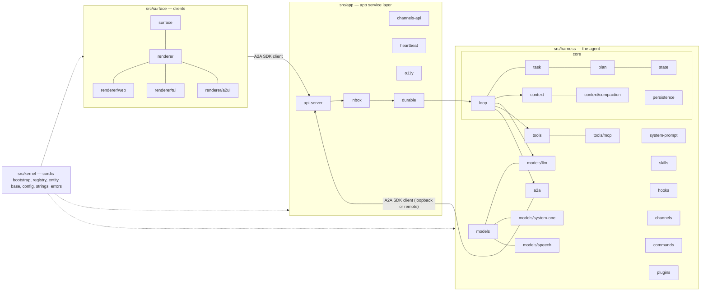
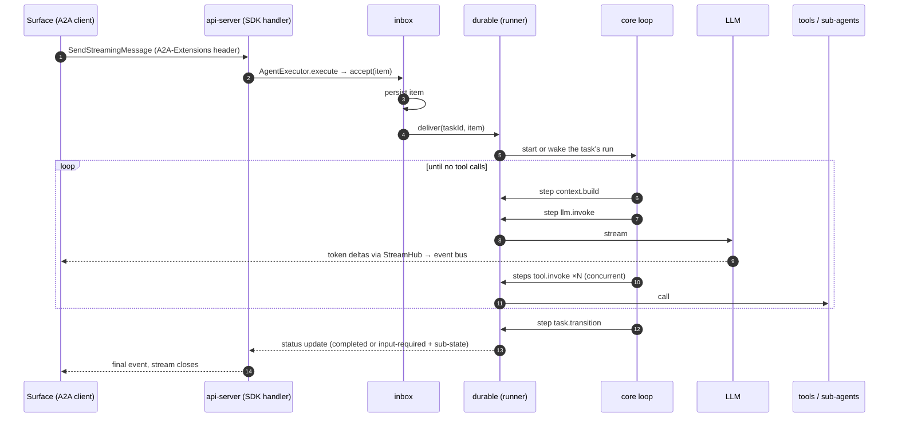
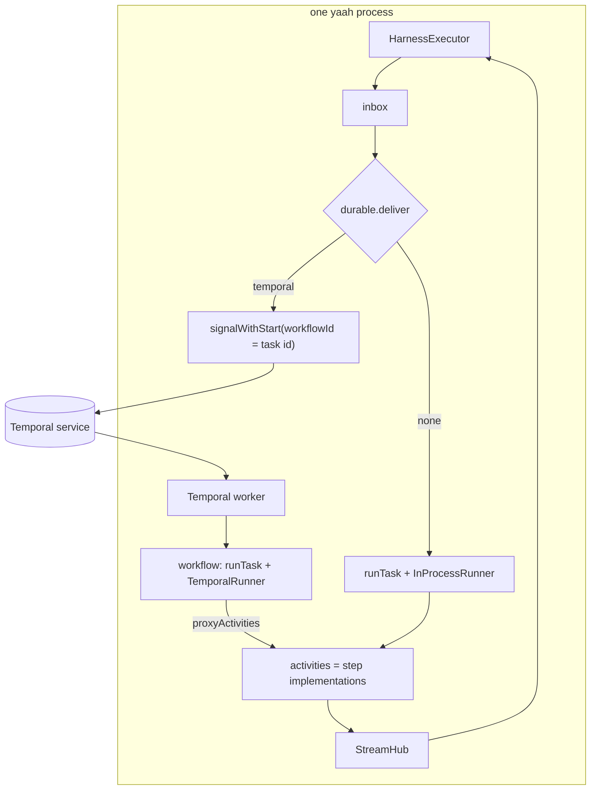

# Design: yaah — Yet Another Agent Harness

> Phase 2 of 3 (requirements → design → tasks). Derives from the approved
> [requirements](requirements.md). MUST be reviewed and approved before moving to tasks
> breakdown.

## Overview

yaah is one npm package, `@yaah/yaah`, whose every capability is a
[cordis](https://github.com/cordiverse/cordis) plugin wired together by a YAML file. A
request enters as an A2A 1.0 message, is stored in a durable inbox, and is worked by one
loop function that runs unchanged in-process or inside a Temporal workflow.

Five decisions carry the design. Each is argued in [Trade-offs & decisions](#trade-offs--decisions).

| # | Decision | Why |
| --- | --- | --- |
| 1 | The core loop is a **pure function over a `StepRunner`**. Two runners exist: in-process and Temporal. | One loop to test; durability becomes a composition choice (R17.1, R17.6). |
| 2 | A long-running task stays in `TASK_STATE_INPUT_REQUIRED` with a **sub-state in metadata**, defined by a yaah A2A extension. | A2A 1.0 forbids extensions from adding task states and forbids messages to terminal tasks (R14). |
| 3 | The server uses the A2A SDK's own request handler and Express adapter; **every surface uses the SDK client** — over HTTP, or over an in-memory transport in the browser build. | "No hand-rolled A2A" (R13.1, R19.2), and the browser build needs no server (R25.2). |
| 4 | Conversation content lives in yaah's store; **Temporal history carries references**, not content. | Temporal's 2 MB payload limit, and customer text stays out of a third-party service by default. |
| 5 | Pin `cordis@4.0.0-rc.13` exactly, behind a 150-line kernel module. | There is no stable cordis 4; its API changes daily. |

**What it costs.** Three things the reviewer should know before approving:

- cordis 4 is a release candidate. A breaking change upstream costs us a kernel-module
  edit, and we do not upgrade without a reason.
- Temporal's worker is officially supported on Node 20–24 only. It passed a smoke test on
  Bun 1.4 and Node 26 on this machine; durable modes are **supported on Node LTS and
  best-effort on Bun**.
- This work item supports **one harness process per data store**. The default store
  is a SQLite file and the stream hub is in-process, so the API server and the Temporal
  worker run together. Running several replicas needs a shared store and a shared
  stream hub, both of which are plugin seams here and not shipped
  ([Durable execution](#durable-execution)).

**What to check first.** [The A2A extensions](#a2a-extensions) (the public protocol
surface), [Durable execution](#durable-execution) (the answers to the issue's Temporal
questions), and [Open questions](#open-questions) — four, each with a default.

### What research changed

Facts verified on 2026-11-14 that differ from what the issue assumes:

| Topic | Finding | Effect on the design |
| --- | --- | --- |
| A2A custom task states | Not allowed: "Extensions should use existing enum values and annotate additional semantic meaning in the `metadata` field." | Decision 2. |
| A2A long-running tasks | No recommendation. A terminal task cannot receive messages; a follow-up must be a new task in the same context. | Staying non-terminal is the only conformant way to keep one task open. |
| Agent Plugins spec v1.0.0 | Defines `plugin.json`, `skills/` and `mcp.json` only. **No hooks, no commands.** | R9.2–9.3: hooks and commands ship through the spec's client-extension namespace ([Agent plugins](#skills-agent-plugins-and-hooks)). |
| Agent Skills | The reference implementation is Python and "not meant to be used in production". No official TypeScript library. | In-house parser and validator, about 150 lines. |
| "GPT 6.1" | No model `gpt-6.1`. The ids are `gpt-6.1-sol` and `gpt-6.1-terra`. Tool calling needs the Responses API. | Default `gpt-6.1-sol` ([open question 1](#open-questions)). |
| OpenAI decisions model | The Decisions API, `POST /v1/decisions`, model `gpt-6-luna`: typed answers (predicate, choice, score) with probabilities. | The System One interface mirrors it (R7.5–7.6). |
| OpenAI TTS | `tts-1`, `tts-1-hd`, `gpt-4o-mini-tts` shut down on 2027-01-06. | Voice output uses the Realtime API (`gpt-realtime-2.1-mini`). |
| A2UI | Now v1.0; the default catalog is called **basic** (18 components). No official terminal renderer. | A terminal renderer for the basic catalog is ours to write. |
| shadcn AI Elements | The npm `ai-elements` CLI is deprecated this month; shadcn/ui now ships them as copy-in patterns. | Components are copied into the repository, no runtime dependency. |
| MCP TypeScript SDK | v2 is stable as `@modelcontextprotocol/client@2.4.0`. | Use v2. |

## Architecture

The source tree is the issue's diagram: three columns, one directory per box (R26.3).



`src/kernel` is not in the issue's picture: it holds what all three columns share.
`src/cli` (the `yaah` command) and `src/compositions` (the `cordis.yaml` files) sit
beside them.

### One request, end to end



Steps 3–4 are what make the inbox durable (R15.2): the item is on disk, or in Temporal's
history as a signal, before the A2A call is acknowledged.

### Composition

A build is a root YAML that includes shared YAML files and patches them (R1.2).

```text
src/compositions/
  shared/core.yml        kernel services, registry, strings, o11y, persistence, core loop, context
  shared/models.yml      llm providers, system-one, speech
  shared/extensions.yml  tools/mcp, skills, plugins, hooks, commands, a2a sub-agents, channels
  shared/app.yml         a2a request handler + HarnessExecutor, inbox, stream hub, durable,
                         heartbeat, channels-api — no network listener
  shared/http.yml        Express listener: A2A routes, agent card, origin check, web assets
  cli.yml                include core, models, extensions, app, http; + surface/tui
  server.yml             include core, models, extensions, app, http
  browser.yml            include core, models, extensions, app; + surface/web;
                         patches: memory persistence, durable none, no stdio MCP, no fs
```

An entry is a cordis loader entry, addressed by `id` so that an operator's file can
replace it (R1.3):

```yaml
# src/compositions/shared/models.yml
- id: llm-openai
  name: "@yaah/yaah/harness/models/llm/openai"
  config:
    apiKeyEnv: OPENAI_API_KEY
    models:
      - { id: gpt-6.1-sol, contextWindow: 1050000, maxOutput: 128000 }
```

- **Reuse** is the `@cordisjs/include` plugin with `patches`, which override keys by
  entry `id` — the mechanism behind both per-build roots and operator overrides.
- **`!!js` expressions are not used** in any shipped file. Secrets are named, never
  interpolated (`apiKeyEnv`), which also keeps the browser build free of `eval`.
- **Browser.** The cordis loader imports `node:fs`. `bun run build:browser` therefore
  resolves `browser.yml` at build time into a static entry list and an import map, and
  the runtime walks that list with `ctx.use`. A plugin that declares
  `static runtime = ["node"]` fails that build by name (R25.3).
- **The browser build has the whole app layer, minus the listener.** `shared/app.yml`
  provides the SDK request handler, the inbox and the in-process runner. What differs
  is the `HarnessTarget` service — how an A2A client reaches this harness:

  | Build | `ctx.harnessTarget` | Used by |
  | --- | --- | --- |
  | cli, server | `{ type: "http", url }` — the listener's own address | surfaces, the `self` sub-agent |
  | browser | `{ type: "in-memory", handler }` | the web surface, the `self` sub-agent |

  The in-memory target is an implementation of the SDK's `Transport` interface whose
  methods call the same `DefaultRequestHandler` directly, so the SDK `Client` and all of
  its types are unchanged and no bytes leave the tab (R25.2, R11.4).

## Components & interfaces

Types below are the contracts (R26.7). Models are [zod](https://zod.dev) 4 schemas with
inferred types — zod is already a dependency of the MCP and A2UI packages, implements
Standard Schema (which cordis validates plugin config with), and emits JSON Schema for
the contract tests. `Json` is a recursive JSON value type; nothing is `any`.

### Kernel

```ts
/** Address of an entity instance. `version` is null for kinds that are not versioned. */
interface EntityRef<K extends EntityKind = EntityKind> {
  readonly kind: K;
  readonly id: string;
  readonly version: string | null;
}
type EntityKind =
  | "prompt" | "skill" | "tool" | "llm" | "system-one" | "speech-to-text"
  | "text-to-speech" | "agent" | "command" | "channel" | "surface" | "renderer";

/** Where an entity runs. A remote entity names the protocol that reaches it (R2.4). */
type Locality =
  | { readonly type: "local" }
  | { readonly type: "remote"; readonly protocol: "a2a" | "mcp" | "https"; readonly url: string };

interface Entity<K extends EntityKind> {
  readonly ref: EntityRef<K>;
  readonly description: string;
  readonly locality: Locality;
}

interface Registry {
  /** @throws EntityConflictError unless `opts.override` is true (R2.6). */
  register<K extends EntityKind>(entity: EntityOf<K>, opts?: { override?: boolean }): Disposer;
  /** @throws EntityNotFoundError — never substitutes another version (R2.5). */
  resolve<K extends EntityKind>(ref: EntityRef<K>): EntityOf<K>;
  list<K extends EntityKind>(kind: K): readonly EntityOf<K>[];
}
```

- `Registry` is a cordis service (`ctx.registry`). `register` runs inside `ctx.effect`,
  so disposing a plugin removes what it registered (R1.5).
- `kernel/bootstrap.ts` is the only file that imports cordis' loader packages. It
  creates the `Context`, installs fs and the loader, and loads the root YAML. A plugin
  that fails to load aborts start with `PluginLoadError { entryId, name, cause }` (R1.4).
- `kernel/strings.ts` loads `src/locales/<locale>.json` and exposes
  `t(key, params)`; a missing key falls back to `en` (R10.4–10.5). A lint rule
  (`no-restricted-syntax` on string literals passed to render, log-to-user and error
  `message` positions) plus a test that scans the bundle keeps literals out.
- `kernel/config.ts` reads `~/.yaah/config.toml` ([Data models](#configuration)).

### Core loop

The loop is pure: it imports no I/O and reaches the world only through `StepRunner`.
That is what lets Temporal bundle it as a workflow.

```ts
/** The sherma `Agent` surface, in A2A 1.0 types from `@a2a-js/sdk` (R3.1). */
interface Agent extends Entity<"agent"> {
  sendMessage(request: Message, opts?: AgentCallOptions): AsyncIterable<StreamResponse>;
  cancelTask(request: CancelTaskRequest, opts?: AgentCallOptions): Promise<Task>;
  getCard(): Promise<AgentCard>;
}

/** Everything the loop may do that is not deterministic computation. */
interface StepRunner {
  /** Runs a named step once and records its result; a recorded step is never re-run (R17.3). */
  step<N extends StepName>(name: N, input: StepInput<N>, opts?: StepOptions): Promise<StepOutput<N>>;
  /** Waits for the next undelivered inbox item. @throws TaskCancelledError on CancelTask. */
  nextInboxItem(): Promise<InboxItemRef>;
  /** Returns the items that arrived since the last call, without waiting (R15.5). */
  drainInbox(): readonly InboxItemRef[];
  /** Runs `fn` in a scope that an item marked `interrupt` aborts with TurnInterruptedError. */
  interruptible<T>(fn: () => Promise<T>): Promise<T>;
  /** Runs `fn` shielded from cancellation — for the final transition. */
  shielded<T>(fn: () => Promise<T>): Promise<T>;
  readonly limits: { readonly maxIterations: number; readonly maxTaskTokens: number };
}

type StepName =
  | "conversation.accept" | "context.build" | "context.compact" | "llm.invoke"
  | "tool.invoke" | "agent.invoke" | "task.transition" | "state.write" | "command.run";

interface StepOptions {
  readonly retry: RetryPolicy;      // default below
  readonly retrySafe: boolean;      // false → at most one attempt once started (R17.5)
  readonly timeoutMs: number;
}
interface RetryPolicy {
  readonly initialIntervalMs: number;   // 1000
  readonly backoffCoefficient: number;  // 2
  readonly maximumIntervalMs: number;   // 60000
  readonly maximumAttempts: number;     // 5
}

/** One task's whole life: wake on inbox, think, act, wait. */
declare function runTask(runner: StepRunner, init: TaskRunInit): Promise<TaskOutcome>;
```

The body is the issue's pseudocode with the waits, the interrupts and the cancel path
made explicit:

```ts
try {
  while (true) {
    const item = await runner.nextInboxItem();                  // idle: wake on input
    if (isLifecycleAction(item)) return await finish(runner, item);   // client completes
    if (await isCommand(item)) { await runner.step("command.run", item); continue; }
    await runner.step("conversation.accept", { items: [item] });

    turn: for (let i = 0; ; i++) {
      if (i >= runner.limits.maxIterations) throw new LimitError("iterations");   // R3.6
      if (usage.total >= runner.limits.maxTaskTokens) throw new LimitError("tokens");
      const late = runner.drainInbox();                         // R15.5: every iteration
      if (late.length > 0) await runner.step("conversation.accept", { items: late });
      try {
        const reply = await runner.interruptible(async () => {
          const ctx = await runner.step("context.build", { taskId });
          const r = await runner.step("llm.invoke", { contextRef: ctx.ref });
          await Promise.all(r.toolCalls.filter(isOrdinary).map((c) => invoke(runner, c)));  // R3.3–3.4
          return r;
        });
        usage = add(usage, reply.usage);
        const ask = reply.toolCalls.find(isAskUser);            // a suspending call
        if (ask) {
          await runner.step("task.transition", { to: "input-required", subState: "awaiting-user-input", question: ask });
          const answer = await runner.nextInboxItem();          // the persisted continuation
          await runner.step("conversation.accept", { items: [answer], asResultOf: ask.id });
          continue turn;
        }
        if (reply.toolCalls.length === 0) {
          const more = runner.drainInbox();                     // nothing unread → the turn is over
          if (more.length === 0) break turn;
          await runner.step("conversation.accept", { items: more });
        }
      } catch (e) {
        if (!(e instanceof TurnInterruptedError)) throw e;      // interrupt: loop again with the item
      }
    }
    const next = await runner.step("task.transition", { reason: "turn-complete" });
    if (isTerminal(next.state)) return next;                    // not long-running → completed
  }
} catch (e) {
  const to = e instanceof TaskCancelledError ? "canceled" : "failed";
  return await runner.shielded(() => runner.step("task.transition", { to, cause: describe(e) }));
}
```

- **`ask_user` suspends the loop, not an activity.** The call is never executed as a
  tool. The loop moves the task to `input-required / awaiting-user-input`, waits on the
  inbox, and stores the user's reply as that call's result (`asResultOf`). The pending
  call id is loop state — workflow state under Temporal, the step journal in-process —
  so a restart resumes the wait (R14.5). A model that issues `ask_user` beside other
  calls gets the other results first; a second `ask_user` in the same reply is answered
  with an error result telling it to ask one question at a time.
- **Late items are read at every iteration** (`drainInbox`), and a turn does not end
  while one is unread, so a default task cannot complete past a message (R15.5).
- **Cancel reaches every wait.** `nextInboxItem` and every step reject with
  `TaskCancelledError`; the outer handler records `canceled` in a shielded step, so an
  idle long-running task is cancelled the same way as a working one (R3.5, R14.6).
- **Token budget.** `usage` accumulates provider-reported input and output tokens for
  the task; reaching `limits.max_task_tokens` fails the task before the next model call
  (abuse case 9).

- **Parallel tool calls** are `Promise.all` over steps; results are stored by call id
  and the next `context.build` emits them in the order the calls were issued (R3.3). A
  failed call becomes a `ToolErrorResult` for that id; the others are unaffected (R3.4).
- **Step inputs and outputs are references and small values** — message ids, tool call
  ids, token counts — never message bodies (Decision 4).
- **In-flight steps receive an `AbortSignal`** on interrupt and on cancel, passed to the
  provider SDK and to the tool.

### Task, plan, step, state

- The **task model** (R4.1) is stored on the A2A `Task` as
  `task.metadata[TASK_MODEL_URI]`; there is no second task table (R4.2). See
  [A2A extensions](#a2a-extensions) for the schema.
- **Plan and steps** are exposed to the LLM as two tools, `plan_set` and
  `plan_update_step`. `plan_set` validates the DAG — unique step names, known
  dependencies, no cycle (Kahn's algorithm) — and returns the rejection reason as the
  tool result (R4.4).
- **State** is a per-task key-value store with tools `state_get` / `state_set`. A plugin
  may register a schema for a key prefix; a write that fails it is rejected (R5.2).

### Persistence

One interface per concern, so that each is replaceable alone (R5.5). Exactly-once does
not rest on a transaction across them — a replaced store may live elsewhere — but on
one rule: **every write is keyed by the step that makes it and replaces what that step
wrote before.**

```ts
/** Identifies one execution point of one task. Stable across retries and replays. */
type StepKey = `${TaskId}/${number}/${StepName}/${string}`;

interface ConversationStore {           // messages, tool calls and results, compaction summaries
  /** Replaces whatever `key` wrote earlier; a retry therefore never duplicates (R15.6). */
  put(key: StepKey, events: readonly ConversationEvent[]): Promise<void>;
  read(taskId: TaskId, range?: SeqRange): Promise<readonly ConversationEvent[]>;
}
interface StateStore { get(taskId: TaskId, k: string): Promise<Json | undefined>;
                       set(key: StepKey, k: string, value: Json): Promise<void>; }
interface PlanStore  { load(taskId: TaskId): Promise<Plan | undefined>;
                       save(key: StepKey, plan: Plan): Promise<void>; }   // revision-checked
interface InboxStore { put(item: InboxItem): Promise<"stored" | "duplicate">;
                       pending(taskId?: TaskId): Promise<readonly InboxItem[]>;
                       markProcessed(ids: readonly InboxItemId[]): Promise<void>; }
interface StepJournal { get(key: StepKey): Promise<StepRecord | undefined>;      // mode "none" only
                        record(key: StepKey, result: Json): Promise<void>; }
// A2A tasks: the SDK's own `TaskStore` interface (save / load / list).
```

How a crash at any point resolves, for the step `conversation.accept` (the only one that
consumes inbox items):

| Crash after | On retry of the same `StepKey` | Result |
| --- | --- | --- |
| nothing written | `put` writes the events | consumed once |
| `ConversationStore.put` | `put` replaces the same events; `markProcessed` runs | consumed once |
| `InboxStore.markProcessed` | both are no-ops; the step result is recorded | consumed once |

The step result — in Temporal's history, or in `StepJournal` — is recorded last, and a
recorded step is never run again. `llm.invoke` and `tool.invoke` follow the same rule:
their output is `put` under their own key, so a retried model call replaces the
abandoned attempt's partial output instead of appending to it.

| Build | Default backend |
| --- | --- |
| cli, server | SQLite at `~/.yaah/data/yaah.db`, through Kysely — the A2A SDK already ships a Kysely `DatabaseTaskStore`, so tasks and yaah's four stores share one database and one dependency. |
| browser | In-memory (IndexedDB is a later plugin). |

Writes complete before the step that caused them returns (R5.3). On start, every
non-terminal task is re-attached to its run (R5.4). `persistenceContract(factory)`
tests the replace-by-key rule against any implementation.

### Context window manager and compaction

`context.build` assembles the request from ordered **sections**. Each section renders
to provider-neutral blocks and reports a content hash.

| # | Section | Changes when | Cache boundary after |
| --- | --- | --- | --- |
| 1 | System prompt (`prompts/system.md` + extensions) | configuration changes | |
| 2 | Skills (name + description each) | a skill is registered | |
| 3 | Sub-agents and tool declarations | a tool or agent is registered | yes |
| 4 | Task (model, participants, role prompt) | task metadata changes | |
| 5 | Plan snapshot | at turn start and at compaction | yes |
| 6 | Conversation | every step (append-only) | yes (moving) |

- **Third-party text in section 3.** MCP tool descriptions and agent-card
  descriptions are written by whoever runs that server. They are emitted only in the
  provider's tool-definition `description` field — never in the system prompt —
  after stripping control characters and capping at 1,024 characters, and section 1
  states that tool and agent descriptions are third-party data, not instructions. A
  description that changes after registration is logged as `tool.description-changed`.
- **Byte stability (R6.2).** A section whose hash is unchanged is emitted from a cached
  rendering; tools and skills are sorted by id; no timestamp or random id appears in
  sections 1–5.
- **Plan updates do not rewrite position 5 mid-turn.** A change made by
  `plan_update_step` reaches the model as that tool's result, in the conversation.
  Position 5 is re-rendered when a user turn starts and when compaction runs. Rewriting
  it on every step would invalidate the cached conversation behind it each time.
- **Cache boundaries** map to Anthropic `cache_control` breakpoints and OpenAI
  `prompt_cache_breakpoint`; the OpenAI-compatible provider relies on implicit caching.
- **When to compact (R6.3).** Before `llm.invoke`, if
  `estimatedTokens > compaction.threshold × contextWindow` — default `0.8`. The estimate
  is the provider-reported input tokens of the previous call plus `chars / 4` for what
  was appended since.
- **What is kept (R6.4).** Sections 1–5 are never compacted. In the conversation: the
  most recent `compaction.keepRecentFraction` (default `0.2`) of the window, every tool
  call without a result, and any message the task is waiting on an answer to. The rest
  is replaced by one summary event produced by an LLM call with `prompts/compaction.md`.
  Whole provider turns are replaced together, so opaque reasoning blocks are never
  split.
- Compaction is its own step (`context.compact`), emits `context.compacted { before, after }`
  (R6.5). The strategy is the cordis service `ctx.compaction`; a plugin replaces it by
  providing that service (R6.6):

  ```ts
  interface CompactionStrategy {
    /** Chooses what to replace. MUST NOT select a pinned event or split a provider turn. */
    select(events: readonly ConversationEvent[], budget: TokenBudget): CompactionPlan;
    summarize(span: readonly ConversationEvent[], llm: LLM, signal: AbortSignal): Promise<string>;
  }
  ```

### Prompts, skills and channels as entities

```ts
interface Prompt extends Entity<"prompt"> {
  /** Markdown source, with `{{name}}` placeholders. */
  readonly template: string;
  readonly variables: readonly string[];
  /** Ids of prompts appended to this one, in registration order (R10.3). */
  readonly extensions: readonly EntityRef<"prompt">[];
  /** @throws PromptVariableError when a declared variable is missing. */
  render(vars: Readonly<Record<string, string>>): string;
}
interface Skill extends Entity<"skill"> {
  readonly name: string;                    // equals the directory name
  readonly root: SkillRoot;                 // opaque handle; paths are resolved under it
  readonly metadata: SkillFrontMatter;      // license, compatibility, metadata, allowedTools
  loadBody(): Promise<string>;
  /** @throws PathEscapeError when `relativePath` leaves the skill root. */
  readFile(relativePath: string): Promise<Uint8Array>;
}
interface Channel extends Entity<"channel"> {
  readonly participants: readonly Participant[];
  send(to: ParticipantId, message: Message): Promise<void>;
  /** @throws NotAParticipantError when `from` is not in `participants` (R12.5). */
  receive(from: ParticipantId, message: Message): Promise<void>;
}
```

Every prompt sent to a model is a `prompt` entity loaded from `src/prompts/*.md`
(`system`, `roles`, `compaction`, `a2ui`, `untrusted-data`); registering one with the
same id and `override: true` replaces it, and `extends: <id>` appends to it (R10.2–10.3).

### Models

```ts
interface LLM extends Entity<"llm"> {
  readonly capabilities: LlmCapabilities;   // contextWindow, maxOutput, input modalities, efforts
  /** @throws LlmError { provider, model, retryable } (R7.4). */
  stream(request: LlmRequest, signal: AbortSignal): AsyncIterable<LlmEvent>;
}
type LlmEvent =
  | { type: "text.delta"; text: string }
  | { type: "tool-call"; call: ToolCall }
  | { type: "reasoning"; opaque: ProviderOpaque }   // replayed unchanged next turn
  | { type: "done"; usage: TokenUsage; stopReason: StopReason };

interface SystemOne extends Entity<"system-one"> {
  /** Fast typed judgements with probabilities (R7.5). */
  decide(input: SystemOneInput, questions: readonly Question[], signal: AbortSignal): Promise<readonly Answer[]>;
}
type Question =
  | { type: "predicate"; id: string; text: string }
  | { type: "choice"; id: string; text: string; choices: readonly Choice[] }
  | { type: "score"; id: string; text: string; levels: number };
type Answer =
  | { type: "predicate"; id: string; probability: number }
  | { type: "choice"; id: string; choice: string; confidence: number }
  | { type: "score"; id: string; score: number; confidence: number }
  | { type: "refusal"; id: string; reason: string };
```

| Entity | SDK | API used | Note |
| --- | --- | --- | --- |
| `llm/openai` | `openai` 7.x | Responses, `store: false`, encrypted reasoning passed back | Required for tool calling on GPT 6.x. |
| `llm/anthropic` | `@anthropic-ai/sdk` 1.x | Messages | All `tool_result` blocks of a turn go in one user message. |
| `llm/openai-compatible` | `openai` 7.x with `baseURL` | Chat Completions | The common denominator of OpenRouter and Ollama (R7.2). |
| `system-one/openai` | `openai` 7.x | Decisions, `gpt-6-luna` | P1. |
| `speech/openai-stt` | `openai` 7.x | `audio.transcriptions`, `gpt-transcribe`, streamed | P1. |
| `speech/openai-tts` | `openai` 7.x | Realtime over WebSocket, `gpt-realtime-2.1-mini` | P1; the `/audio/speech` models end 2027-01-06. |

`/model` and `/effort` set two keys in the context's settings; `llm.invoke` resolves the
LLM entity from them, falling back to `config.model`.

### Tools and MCP

```ts
interface Tool extends Entity<"tool"> {
  readonly inputSchema: JsonSchema;          // required — a tool without one is not registered
  readonly retrySafe: boolean;               // MCP: readOnlyHint || idempotentHint
  invoke(args: Json, ctx: ToolCallContext): Promise<ToolResult>;
}
type ToolResult =
  | { ok: true; content: readonly ContentPart[]; structured?: Json }
  | { ok: false; error: ToolError };         // returned to the LLM, never thrown past the loop
```

- `tools/mcp` connects with `@modelcontextprotocol/client` 2.4 over stdio or Streamable
  HTTP, lists tools, and registers each as `tool` entity `mcp.<server>.<tool>` with
  `locality: remote/mcp` (R8.1). A server that is down at start is logged and retried
  with backoff; its tools appear when it connects (R8.4).
- Arguments are validated against `inputSchema` with `@cfworker/json-schema` before the
  call (R8.3) — chosen over Ajv because it does not generate code, so it runs under a
  strict browser CSP.
- yaah registers **no** file, shell or network tool of its own (R8.2). Its built-in
  tools act only on its own state: `plan_set`, `plan_update_step`, `state_get`,
  `state_set`, `ask_user`, `invoke_agent`, `load_skill`, `read_skill_file`, and (P1)
  `message_participant`, `create_task_for_participant`, `generate_image`.

### Skills, agent plugins and hooks

- **Skills (R9.1).** `skills/` scans configured directories for `<name>/SKILL.md`,
  validates the front matter against the specification's rules (name pattern and
  equality with the directory name, description length, field types), and registers a
  `skill` entity. Only name and description enter the context; `load_skill` returns the
  body, `read_skill_file` returns a file under the skill root. Scripts are **not**
  executed: yaah has no shell. A skill that needs one works when the operator adds a
  tool that provides it.
- **Agent plugins (R9.2).** `plugins/` loads a directory holding `plugin.json`, with the
  two JSON Schemas of spec 1.0.0 vendored into the repository (the spec forbids fetching
  them at load time). It registers `skills/*/SKILL.md` and the servers in `mcp.json`,
  expanding only `${PLUGIN_ROOT}` and `${PLUGIN_DATA}`. Programmatic use is the same
  code path with an in-memory manifest.
- **Hooks and commands for file plugins.** The specification has neither, but reserves
  reverse-domain **client extensions**. yaah defines the namespace
  `io.github.madarauchiha-314.yaah` (a directory of that name in the plugin):

  ```jsonc
  // io.github.madarauchiha-314.yaah/hooks.json
  { "hooks": [ { "event": "tool.before", "match": "mcp.crm.*",
                 "run": { "type": "mcp-tool", "server": "policy", "tool": "check" } } ] }
  ```

  A hook is an MCP tool from the plugin's own `mcp.json`, called with the event as its
  argument and answering `{ "decision": "allow" | "deny", "reason": string }`. That
  keeps hooks shell-free. `commands/<name>.md` in the same directory registers a prompt
  command.
- **Hooks service (R9.3).** `hooks/` exposes typed lifecycle points —
  `message.received`, `llm.before`, `llm.after`, `tool.before`, `tool.after`,
  `agent.before`, `task.transition`. Programmatic hooks are cordis listeners;
  `tool.before`, `agent.before` and `message.received` are dispatched with
  `ctx.serial`, run in registration order, and the first `deny` blocks. A hook that
  throws counts as `deny`.

### Sub-agents

- `a2a/` registers one `agent` entity per configured `{ id, cardUrl }`, after fetching
  the card with the SDK's `ClientFactory` (R11.1). The card URL's host must be in
  `agents.allowedHosts`.
- The entity `self` is always registered: an A2A client on `ctx.harnessTarget` — the
  harness's own URL, or the in-memory transport in the browser build. It is how the
  agent gets a fresh context window (R11.4).
- `invoke_agent { agent, message, taskId? }` runs as step `agent.invoke`. It sends with
  the task-model extension active, carrying `parentTasks` and `depth + 1`; consumes the
  stream until the sub-task is terminal or interrupted; and adds a `TaskRef` to the
  parent's `subTasks` (R11.5). The tool result is the sub-task's state and artifacts,
  including `failed`, `canceled`, `rejected` and `input-required` (R11.6).
- `depth > agents.maxDepth` (default `3`) is refused before any call (R11.7).

### A2A API server

Built entirely from `@a2a-js/sdk/server` (R13.1):

| Piece | Source |
| --- | --- |
| Request handling, version and extension checks, terminal-task rejection | SDK `DefaultRequestHandler` |
| JSON-RPC, HTTP+JSON, agent card routes | SDK Express handlers, mounted on Express 5 |
| Task storage | SDK `DatabaseTaskStore` (Kysely) |
| Push notification configuration | SDK stores and `DefaultPushNotificationSender` |
| `AgentExecutor` | yaah's `HarnessExecutor` — the only code we write here |

`HarnessExecutor.execute(requestContext, eventBus)`:

1. Activates the yaah extensions the client requested (`ctx.addActivatedExtension`).
2. Reads the task's current hub sequence number and **subscribes from it**.
3. Builds an `InboxItem` from the request and calls `inbox.accept`.
4. Forwards hub events to the SDK event bus as `statusUpdate`, `artifactUpdate` and
   message events.
5. Calls `eventBus.finished()` when the task reaches a terminal or interrupted state.

Subscribing before delivering, from a known sequence number, is what keeps a fast run
from finishing unseen:

```ts
interface StreamHub {
  /** Appends to the task's bounded log and returns the event's sequence number. */
  publish(taskId: TaskId, event: HubEvent): number;
  /** Replays everything after `afterSeq`, then follows live. */
  subscribe(taskId: TaskId, afterSeq: number, signal: AbortSignal): AsyncIterable<SequencedHubEvent>;
  head(taskId: TaskId): number;
}
type HubEvent =
  | { type: "status"; update: TaskStatusUpdateEvent }
  | { type: "artifact"; update: TaskArtifactUpdateEvent }
  | { type: "delta"; stepKey: StepKey; text: string }
  | { type: "reset"; stepKey: StepKey };     // an abandoned attempt's deltas are void
```

- The log holds a task's events since its last terminal or interrupted transition and
  is dropped after it. Status and artifact events are also written to the SDK
  `TaskStore` by the `task.transition` step **before** they are published, so the store,
  not the hub, is the record: a subscriber that finds the log gone reads the task.
- The executor has a backstop: if the hub is silent for 2 s it loads the task from the
  store and, if the task is already terminal or interrupted, emits that status and
  finishes.

`cancelTask` calls `durable.cancel(taskId)`. gRPC is not served: the SDK's gRPC binding
is Node-only and no surface needs it.

### A2A extensions

Everything yaah-specific on the wire is an extension, declared in the agent card (R13.3).
Base URI `https://github.com/MadaraUchiha-314/yaah/extensions` ([open question 3](#open-questions)).
Each has a zod schema in `src/app/api-server/extensions/` and a generated JSON Schema
checked in under `specs/a2a-extensions/` (the contract tests diff them).

| Extension | Carries | Where |
| --- | --- | --- |
| `…/task-lifecycle/v1` | Keep-open request, lifecycle actions, `input-required` sub-state | `message.metadata`, `status.message.metadata` |
| `…/task-model/v1` | Task fields of R4.1, delegation depth | `task.metadata`, `message.metadata` |
| `…/inbox-events/v1` | A2A `Task`, `TaskStatusUpdateEvent`, `TaskArtifactUpdateEvent` as inbox input | a `data` part |
| `…/commands/v1` | Registered command names (card params); command outcome | card, `message.metadata` |
| `…/durable-execution/v1` | Mode, dashboard URL (card params); workflow link per task | card, `task.metadata` |
| `…/channels/v1` (P1) | Channel id and participant on a message | `message.metadata` |
| `…/voice/v1` (P1) | Request for spoken output and its format | `message.metadata` |
| `https://a2ui.org/a2a-extension/a2ui/v1.0` | A2UI — the official extension, not ours | `data` parts |

**Task lifecycle** — the contract behind R14:

```ts
const TaskLifecycleRequest = z.object({
  /** On the message that creates a root task: keep it open after each response. */
  longRunning: z.boolean().optional(),
  /** On a message to an open task: end it without invoking the model. */
  action: z.enum(["complete"]).optional(),
});
const TaskLifecycleStatus = z.object({
  /** Open enumeration: clients MUST treat an unknown value as "awaiting-next-interaction". */
  subState: z.string(),   // "awaiting-next-interaction" | "awaiting-user-input" | future values
  schemaVersion: z.literal(1),
});
```

| Situation | `status.state` | `subState` | The reply is in |
| --- | --- | --- | --- |
| Response delivered, not long-running | `COMPLETED` | — | an artifact, and `status.message` |
| Response delivered, long-running | `INPUT_REQUIRED` | `awaiting-next-interaction` | an artifact, and `status.message` |
| Agent called `ask_user` | `INPUT_REQUIRED` | `awaiting-user-input` | `status.message` (the question) |
| Client sent `action: "complete"` | `COMPLETED` | — | — |
| Client called CancelTask | `CANCELED` | — | — |

- A client that does not know the extension sees a conformant `INPUT_REQUIRED` task and
  can still answer it or cancel it.
- `longRunning` is honoured only on a message that creates a task with no
  `parentTasks`; on a sub-task it is ignored (R14.8).
- Cancel is plain `CancelTask`. Complete is a `SendMessage` with the action in
  metadata, so it works over every binding with the stock SDK client — no new RPC
  method.

**Inbox events** (R15.3). A sender wraps an event as one part
`{ data: <StreamResponse JSON>, mediaType: "application/a2a+json" }` on a `SendMessage`
whose metadata carries `{ interrupt?: boolean }`. A plain message is the fourth kind and
needs no wrapper. An event is accepted only when its task id and context id match a
sub-task this harness delegated (abuse case 10).

### Inbox, heartbeat, channels

- **Inbox.** `accept(item)` derives the item id from `messageId`, writes it
  (`InboxStore.put`, which reports duplicates), then calls `durable.deliver`. The step
  `conversation.accept` moves items into the conversation under its step key and then
  marks them processed; [Persistence](#persistence) shows why that is exactly-once
  (R15.6). An item for a working task is read at the next loop iteration; with
  `interrupt: true` it aborts the current `interruptible` scope first (R15.5).
- **Heartbeat (P1).** A timer plugin emits `heartbeat.tick` every
  `heartbeat.intervalMs` (default 30 s). Its listener re-delivers `InboxStore.pending()`
  items older than one interval and emits `task.stalled` for a working task whose last
  step is older than `heartbeat.stalledAfterMs` (R16).
- **Channels (P1).** A `channel` entity has `participants`, `send` and `receive`. The
  default implementation maps a user participant to the task's own conversation and an
  agent participant to an A2A call. `message_participant` sends and waits for a short
  reply; `create_task_for_participant` creates a sub-task with that participant as
  assignee (R12.2). Membership changes go only through the harness's `ChannelManager`
  (R12.4). Inbound channel messages enter through `ChannelManager.receive(channelId, from, message)`,
  which looks the channel up and rejects the message with `NotAParticipantError` unless
  `from` is one of its participants (R12.5). Without authentication `from` is the
  participant id the sender declares in the `channels` extension; an authentication
  plugin binds it to the authenticated user.

### Durable execution

```ts
interface DurableExecution {
  readonly mode: "none" | "temporal-embedded" | "temporal-remote";
  /** Stores the item durably and starts or wakes the task's run. */
  deliver(taskId: TaskId, item: InboxItemRef): Promise<void>;
  cancel(taskId: TaskId): Promise<void>;
  /** Null in mode "none" (R17.8). */
  dashboard(): { readonly url: string } | null;
  taskUrl(taskId: TaskId): string | null;
}
```



The issue asks nine questions about Temporal. The answers:

| Question | Answer |
| --- | --- |
| Is the core loop a workflow and each operation an activity? | Yes. One workflow per root or sub task, id `yaah-<taskId>`. `conversation.accept`, `context.build`, `context.compact`, `llm.invoke`, each `tool.invoke`, each `agent.invoke` and `task.transition` are activities. |
| When is it safe to retry an activity? | Always for `conversation.accept`, `context.build`, `llm.invoke` and `task.transition` — each writes under its own step key and replaces on retry. For a tool or sub-agent call, only when the tool is `retrySafe`; otherwise `maximumAttempts: 1` and the failure goes to the model (R17.5). |
| What is the retry policy? Exponential backoff? | Yes: 1 s initial, ×2, 60 s cap, 5 attempts, all configurable. Authentication, validation and 4xx provider errors are non-retryable. |
| Core loop only, or the request lifecycle too? | The task's whole life after the inbox accepts it. HTTP handling, the agent card and streaming to the client stay outside Temporal. |
| How does it meet the A2A SDK? | Inside `AgentExecutor.execute`: the executor hands the message to the inbox, which signals the workflow. `cancelTask` cancels the workflow. Clients see the same A2A behaviour in every mode (R17.6). |
| Pod crash while an activity runs? | Temporal cannot see the crash. The activity is retried after its heartbeat timeout (20 s; LLM and tool activities heartbeat while streaming) — unless it is not `retrySafe`, in which case the model is told the outcome is unknown. |
| Does a retried LLM call cause trouble, being non-deterministic? | No. A call that did not complete left no result, so nothing downstream depended on it. The retry produces a different, equally valid reply. Deltas already streamed for the abandoned attempt are superseded by a `reset` event on the stream. |
| Pod crash while the workflow runs — is it all run again? | The workflow code is replayed on another worker, but every completed activity returns its recorded result; no LLM, tool or sub-agent is called again (R17.3). |
| Does non-determinism inside an activity matter, given results are stored? | No — that is exactly why all of it sits in activities. The workflow itself (the loop) is deterministic: ids and time come from Temporal's APIs. |

Further points:

- **Messages are signals** (`signalWithStart`), which Temporal records even when no
  worker is running — that is the durable inbox in Temporal modes. The workflow dedups
  on inbox item id.
- **History size.** The workflow calls continue-as-new at a turn boundary once Temporal
  suggests it; open state travels as references.
- **Streaming and topology.** Activities publish to the `StreamHub`, which is
  in-process: the worker and the API server are the same process, so every delta,
  status and artifact reaches the client exactly as in mode `none` (R17.6). That is the
  one supported topology in this work item — one harness process per data store.
  Several replicas would need a shared store and a shared hub (for example
  `@temporalio/workflow-streams`); both are services a plugin can provide, and neither
  ships here. Start-up refuses a Temporal task queue that another live harness process
  is already polling with a different `instanceId`, rather than silently splitting
  streams.
- **Embedded mode** starts Temporal's development server through
  `TestWorkflowEnvironment.createLocal` with `ui: true`, fixed ports (`7233`, UI `8233`,
  both configurable, bound to loopback) and a database file at
  `~/.yaah/temporal/dev.db`. It downloads the Temporal CLI on first use (about 125 MB).
- **Remote mode** connects with `Connection.connect({ address, tls: true, apiKey })`,
  the key read from the configured environment variable. If the connection fails, start
  fails; there is no fallback (R17.7).
- **Dashboard (R17.8–17.10).** `dashboard()` returns `http://127.0.0.1:<uiPort>` when
  embedded, and `https://cloud.temporal.io/namespaces/<namespace>` when remote
  (overridable with `durable.temporal.uiUrl` for self-hosted clusters). `taskUrl`
  appends `/workflows/<workflowId>/<runId>/history`. The URL is printed at start, sits
  in the agent card's `durable-execution` params, and each task carries its own link in
  `task.metadata` — which is how the TUI and the web UI show them without a second API.
- **Payload privacy.** With Decision 4, history holds ids, tool names, tool arguments
  and token counts. Setting `durable.temporal.encryptionKeyEnv` adds an AES-GCM
  `PayloadCodec` for those too.
- **Mode `none`.** `InProcessRunner` executes steps directly with the same retry
  policy, journals each completed step to SQLite, and on restart resumes a task at its
  last completed step. A step that was in flight is re-run only if `retrySafe`.

### Observability

- **Logging.** One `Logger` service writing JSON lines to stderr; one configuration in
  development and production (R18.3). Every record carries `taskId`, `contextId`,
  `traceId`, `stepName`, and passes through the `Redactor`
  ([Security design](#security-design)) before it is written (R18.4).
- **Events.** The record types are fixed: `request.received`, `inbox.accepted`,
  `context.built`, `context.compacted`, `llm.invoked`, `tool.invoked`, `agent.invoked`,
  `state.written`, `task.transition`, `command.invoked|executed|failed` (R18.1, R23.4).
- **Tracing.** `@opentelemetry/api` in the core; `sdk-trace-base` plus the OTLP/HTTP
  exporter in the server and CLI builds. One trace per request, spans named by the GenAI
  semantic conventions (`chat <model>`, `execute_tool <name>`, `invoke_agent <name>`).
  `traceparent` is propagated by an A2A client interceptor and in MCP `_meta` (R18.2).
  Message content is not put on spans unless `o11y.captureContent` is set.
- **Langfuse (P1).** No extra dependency: an OTLP exporter preset pointing at
  `/api/public/otel` with the Basic header built from two environment variables.

### Surfaces and renderers

```ts
interface Surface extends Entity<"surface"> {
  readonly modalities: readonly ("text" | "image" | "audio")[];
  /** A2A SDK client — the only way a surface reaches a harness (R19.2). */
  connect(target: HarnessTarget): Promise<HarnessSession>;
}
interface Renderer extends Entity<"renderer"> {
  readonly a2uiCatalogs: readonly string[];
  render(event: SurfaceEvent): void;          // unknown part → textual fallback (R19.5)
}
```

- **`surface/session.ts`** is shared by both UIs. Both renderers draw `TaskView`;
  neither parses A2A itself.

  ```ts
  type HarnessTarget =
    | { readonly type: "http"; readonly url: string }
    | { readonly type: "in-memory"; readonly handler: A2ARequestHandler };

  interface HarnessSession {
    readonly card: AgentCard;
    readonly commands: readonly string[];          // from the commands extension
    readonly dashboardUrl: string | null;          // from the durable-execution extension
    /** Sends a turn; creates the task when `taskId` is absent. */
    send(input: TurnInput, opts?: { taskId?: TaskId; longRunning?: boolean }): Promise<void>;
    complete(taskId: TaskId): Promise<void>;
    cancel(taskId: TaskId): Promise<void>;
    /** Lists the tasks of this session's context. */
    tasks(): Promise<readonly Task[]>;
    /** Emits a fresh `TaskView` on every change, until the task is terminal. */
    follow(taskId: TaskId, signal: AbortSignal): AsyncIterable<TaskView>;
  }
  ```
- **Two surfaces on one task (R19.3).** `follow` is a loop, not one call: load the task
  (`getTask`, with history) → `resubscribeTask` → fold events → when the stream closes
  and the task is not terminal, load and subscribe again. The snapshot fills whatever
  happened between two subscriptions, so an observing surface sees the turns another
  surface drives. The SDK keeps a task's event bus alive in `INPUT_REQUIRED`
  (`keepBusAliveStates`); the loop does not depend on that, and a two-client,
  three-turn integration test fixes the behaviour either way.
- **A2UI (R19.4, R19.6).** A2UI 1.0, basic catalog. Agent side: `@a2ui/agent` supplies
  the prompt snippet when the client's message offers the catalog, and parses and
  validates the model's `<a2ui>` blocks into `application/a2ui+json` data parts. Client
  side: `@a2ui/web_core`'s `MessageProcessor` holds surfaces and data models for both
  UIs; a user action is sent back as a data part and reaches the model as a
  conversation event.
- **Web (R20).** Vite, React 19, Tailwind 4, shadcn/ui with its AI Elements patterns
  copied into `src/surface/renderer/web/components/`. A2UI renders through
  `@a2ui/react`'s `A2uiSurface` with the built-in basic catalog, themed by mapping its
  `--a2ui-*` variables to the shadcn tokens. The server build serves the compiled
  assets from the same origin as the API.
- **TUI (R21).** Ink 8 — pure JavaScript, so it runs on Node and Bun alike. A2UI
  renders through our own basic-catalog renderer:

  | Component | In the terminal |
  | --- | --- |
  | Text, Row, Column, List, Card, Divider, Tabs | Ink boxes and text |
  | Button, CheckBox, ChoicePicker, Slider, TextField, DateTimeInput | Focusable controls; Tab moves, Enter or Space acts |
  | Modal | Inline bordered box |
  | Image, Video, AudioPlayer, Icon | Label plus the URL (R19.5) |

  Without a TTY or colour it prints plain lines and reads stdin (R21.2).
- **Voice (P1, R24).** Web: a microphone button records with `MediaRecorder`. TUI:
  hold Space where the terminal reports key release (kitty keyboard protocol),
  otherwise Space toggles; audio is captured by spawning `arecord`, `pw-record` or
  `ffmpeg`, whichever exists. Audio travels as an A2A `raw` part. The harness passes it
  to a model that accepts audio, or transcribes it first. Spoken replies come back as
  `artifactUpdate` chunks (`append`, `lastChunk`) of `audio/pcm`, played as they arrive.

### Commands

```ts
interface Command extends Entity<"command"> {
  readonly name: string;                         // without the slash
  readonly scope: "harness" | "surface";
  run(args: string, ctx: CommandContext): Promise<CommandResult>;
}
```

- Harness commands (`/model`, `/effort`, plugin commands) are matched by the loop
  before the model is called (R23.1); an unknown `/name` returns a message and never
  reaches the model (R23.5). `/exit` is a surface command and stays on the client.
- The agent card's `commands` extension lists the registered names. That list is what
  both renderers use to highlight a matched command while the user types (R20.5).
- A plugin registers one with `ctx.commands.register(name, fn)` (R23.3).

### CLI and SDK

| Invocation | Does |
| --- | --- |
| `yaah` | Starts a harness on `127.0.0.1` (port `7420`, or the next free one), then opens the TUI against it. |
| `yaah serve` | Starts the harness and serves the web UI at `/`. |
| `yaah tui --url <harness>` | Opens the TUI against a harness that is already running. |
| `--config <path>` | Uses that file instead of `~/.yaah/config.toml` (R22.4). |

The TUI always reaches its harness over HTTP on loopback, even in the same process. One
code path serves the local and the remote case, and the loopback sub-agent has a URL to
call.

The package exports each directory as a subpath (`@yaah/yaah/kernel`,
`@yaah/yaah/harness/core`, …) and a `createHarness(options)` function that the CLI
itself calls (R22.6).

## UI/UX design

Two prototypes, both self-contained HTML. They are the visual contract for R20 and R21.
No designer is assigned; the product owner reviews the rendering at this gate.

| Artifact | Type | Location / link | Covers (screen · requirement) | Status |
| --- | --- | --- | --- | --- |
| `design/web-chat.html` | html-prototype | [`design/web-chat.html`](design/web-chat.html) | Web chat · R14, R17.8, R17.10, R19.4, R20, R23, R24.4 | draft |
| `design/tui.html` | html-prototype | [`design/tui.html`](design/tui.html) | Terminal UI · R14, R17.8, R19.4, R21, R23 | draft |

- **Flows & states:** idle; streaming a response; open task awaiting the next
  interaction; the agent asking for input; an A2UI form from the basic catalog; a
  parallel tool call group; a completed task; a command being typed. The web prototype
  switches between them with a state selector that is not part of the product.
- **Design system / tokens:** shadcn/ui neutral tokens, light and dark. One accent, used
  for the input-required state and the primary action only. Task state is shown as a
  labelled pill, never by colour alone.
- **Accessibility & responsiveness:** WCAG 2.1 AA contrast; every control reachable by
  keyboard with a visible focus ring; the transcript is an `aria-live="polite"` log;
  single column below 640 px with the composer pinned to the bottom. The TUI works at
  80 columns and without colour.
- **Evidence:** screenshots under [`design/screenshots/`](design/screenshots/).

## Data models

### Task model (`task-model/v1`)

```ts
const TaskRef = z.object({ taskId: z.string(), contextId: z.string(), agent: EntityRefSchema });
const Participant = z.object({
  id: z.string(),
  role: z.enum(["assignee", "reporter", "watcher", "admin"]),
  kind: z.enum(["user", "agent"]),
  displayName: z.string().optional(),
});
const TaskModel = z.object({
  name: z.string(),
  type: z.string().optional(),
  goal: z.string(),
  description: z.string(),
  acceptanceCriteria: z.array(z.string()),
  subTasks: z.array(TaskRef),
  parentTasks: z.array(TaskRef),
  participants: z.array(Participant),
  depth: z.number().int().min(0),
  schemaVersion: z.literal(1),
});
```

When a client creates a task with only a text message, `name` and `goal` are derived
from the first message and the sender becomes the `reporter`; the harness is the
`assignee`.

### Plan

```ts
const Step = z.object({
  name: z.string(),
  description: z.string(),
  dependsOn: z.array(z.string()),
  status: z.enum(["pending", "in-progress", "done", "skipped", "failed"]),
  output: z.string().optional(),
  linkedTasks: z.array(TaskRef),
});
const Plan = z.object({ taskId: z.string(), steps: z.array(Step), revision: z.number().int() });
```

### Conversation event

```ts
type ConversationEvent =
  | { seq: number; type: "message"; role: "user" | "agent"; parts: readonly ContentPart[]; messageId: string }
  | { seq: number; type: "tool-call"; call: ToolCall; opaque?: ProviderOpaque }
  | { seq: number; type: "tool-result"; callId: string; result: ToolResult }
  | { seq: number; type: "a2ui-action"; action: A2uiAction }
  | { seq: number; type: "inbox-event"; event: StreamResponse }
  | { seq: number; type: "summary"; replaces: SeqRange; text: string };
```

### Configuration

`~/.yaah/config.toml`, created on first run with these defaults and comments (R22.3).
The schema is a zod object with `.strict()`: an unknown key is an error naming the file
and key (R22.5). It is published as `specs/config/config.schema.json`.

```toml
composition = "cli"              # "cli" | "server" | a path to a root cordis.yaml
locale = "en"
model = { llm = "openai/gpt-6.1-sol", effort = "medium" }

[server]
host = "127.0.0.1"
port = 7420
allowed_origins = []             # browser origins besides the harness's own

[providers.openai]
api_key_env = "OPENAI_API_KEY"   # a variable NAME — never a value
[providers.anthropic]
api_key_env = "ANTHROPIC_API_KEY"

[durable]
mode = "none"                    # "none" | "temporal-embedded" | "temporal-remote"
[durable.temporal]
address = ""                     # e.g. "yaah.gtebu.tmprl.cloud:7233"
namespace = "default"
api_key_env = "TEMPORAL_API_KEY"

[limits]
max_iterations = 50
max_agent_depth = 3
max_body_bytes = 10485760
max_parts = 32
max_open_tasks_per_caller = 20   # caller = authenticated user, else remote address
max_requests_per_minute = 120    # per caller
max_task_tokens = 2000000        # input + output, cumulative per task

[compaction]
threshold = 0.8
keep_recent_fraction = 0.2

[[mcp.servers]]                  # none by default
[[agents]]                       # none by default
[[plugins]]                      # none by default
```

`[[overrides]]` entries (`id`, `name`, `config`, `disabled`) become
`@cordisjs/include` patches on the chosen composition — the operator's way to replace
any default plugin without writing YAML (R1.3).

## Error handling

Every error a caller can see is a subclass of `YaahError { code, message, cause }` with
a message from the strings file.

| Failure | Surfaced as |
| --- | --- |
| Bad config, unknown key, missing required credential, plugin fails to load, remote Temporal unreachable | Start aborts, exit code 1, one line naming file, key or plugin and the reason. |
| Malformed A2A request, terminal task, unsupported required extension | The SDK's A2A error; no task is created (R13.4–13.5, R14.7). |
| Request over a size, open-task or rate limit | An A2A error before any model call (abuse case 8). |
| LLM error, retryable | Retried by the step policy; logged per attempt. |
| LLM error, exhausted or non-retryable | Task → `FAILED` with `LlmError.code` in `status.message`. |
| Tool or sub-agent failure | A `ToolErrorResult` to the model; the task continues (R8.5, R11.6). |
| Hook denies | A `ToolErrorResult { code: "denied", reason }` to the model. |
| Iteration, task-token or depth limit | Task → `FAILED` naming the limit (R3.6), or the call is refused (R11.7). |
| Renderer cannot draw a part | Textual fallback; a warning in the log (R19.5). |
| Microphone unavailable | A message in the UI; text input unaffected (R24.6). |

Each row logs one structured record with the same fields in every environment.

## Security design

No authentication is in scope (decided in review). The design therefore limits what an
unidentified caller can reach and makes the missing check a single, replaceable point.

- **AuthN/AuthZ:**
  - None by default. The SDK's `UserBuilder` is the extension point the requirements
    ask for: `api-server` takes it from the service `ctx.auth`, whose default is
    `UserBuilder.noAuthentication`. An authentication plugin provides `ctx.auth` and an
    `OwnerResolver`; no other code changes. With no such plugin the agent card declares
    no security scheme.
  - Without identity, the limits are network-level: the server binds `127.0.0.1` unless
    `server.host` says otherwise, and the embedded Temporal server and its UI bind
    loopback too (abuse case 1).
  - **Origin check.** An Express middleware ahead of the SDK handlers rejects, with
    403, any request whose `Origin` header is present and is neither the server's own
    origin nor in `server.allowed_origins`. CORS preflight is answered only for those
    origins. This stops a web page the user happens to visit from driving a local
    harness (abuse case 2).
- **Input validation & injection surfaces:**
  - _A2A ingress._ The SDK validates protocol shape; yaah's extension metadata is parsed
    with zod and an invalid payload is rejected. Body size, part count and part size
    are checked before the inbox accepts. A **caller key** — the authenticated user
    when an authentication plugin is installed, otherwise the connection's remote
    address — is counted against `max_open_tasks_per_caller` and a sliding-window
    `max_requests_per_minute`; a request over either is rejected before the inbox
    (abuse case 8). `X-Forwarded-For` is ignored unless `server.trust_proxy` is set.
  - _LLM output → actions._ A tool call is executed only if the tool is registered and
    in the task's tool set, and only after its arguments pass the tool's JSON Schema
    (abuse case 3). `invoke_agent` accepts only registered agent ids — the model cannot
    supply a URL.
  - _Prompt injection._ Tool results and sub-agent replies enter the context only as
    tool-result blocks in the conversation. Tool and agent **descriptions** appear in
    section 3 only inside tool-definition `description` fields, sanitized and capped
    as described under the context manager, and never in sections 1–2. No tool exists
    that changes configuration, registers a tool or widens the tool set, so injected
    text has nothing to escalate to (abuse case 4).
    This limits the damage of an injection; it does not prevent a model from being
    misled within the tools it already has.
  - _A2UI → DOM._ The model's A2UI is validated against the basic catalog by
    `@a2ui/agent` before it is sent; the client's `MessageProcessor` rejects unknown
    components. The basic catalog has no raw-HTML component. `openUrl` and image
    sources are restricted to `https:` and `data:image/`; markdown is rendered with
    HTML disabled (abuse case 5).
  - _Terminal._ Every string drawn by the TUI passes through a filter that strips C0
    and C1 control characters and escape sequences (abuse case 6).
  - _SSRF._ Agent-card and MCP URLs come only from configuration, and their hosts are
    checked against `agents.allowedHosts` / the configured server list. A URL arriving
    in a message is data and is never fetched by the harness (abuse case 7).
  - _Paths._ Skill and plugin paths are resolved with `realpath` and must stay under
    their configured root; `read_skill_file` applies the same check (abuse case 11).
  - _Inbox events._ Accepted only for a delegated sub-task, matched on task id and
    context id (abuse case 10).
- **Secrets handling:** credentials are read from environment variables named in the
  configuration, at the moment a provider is constructed, and held only in that
  provider instance. They are never written to `config.toml`, the stores, prompts or
  Temporal payloads. One `Redactor` service knows every configured credential value
  and replaces **each occurrence as a substring**, in any string, with `[redacted]`;
  it also blanks values under sensitive key names. It runs at four exits: log
  records, span attributes, errors returned to callers (which carry codes and
  string-table messages, not upstream bodies), and — so that a tool or sub-agent
  echoing a credential cannot plant it in a prompt — every tool result and sub-agent
  reply before it is written to the conversation (abuse case 12). The generated config file is created with mode `0600`.
- **Least privilege:** the harness has no file, shell or network tool of its own. MCP
  stdio servers start with only the environment variables their entry lists. Plugin
  hooks can deny an action but cannot rewrite it. The browser build has no fs service
  and no stdio transport.
- **Fail-closed behaviour:** unknown config key, invalid YAML, a plugin that fails
  validation, a missing required credential, or unreachable remote Temporal → the
  process does not start. A tool without an input schema is not registered. A hook
  that throws denies. A non-loopback bind starts, and prints
  `server.unauthenticated-bind` naming the address on every start.
- **Abuse-case coverage:**

  | # | Abuse case | Mechanism | Negative test |
  | --- | --- | --- | --- |
  | 1 | Default bind | `server.host` default `127.0.0.1`; embedded Temporal the same | Start with no host; assert the listening address and that a non-loopback connect is refused. |
  | 2 | Foreign `Origin` | Origin middleware | POST with `Origin: https://evil.example` → 403, no task. |
  | 3 | Unregistered tool or agent | Registry lookup + task tool set | Scripted model requests `rm_rf` → `ToolErrorResult`, nothing invoked. |
  | 4 | Injected instructions | Data-only placement; no escalation tools | Tool result says "register tool X" → tool set unchanged; rendered context shows it inside a result block. |
  | 5 | Hostile A2UI | Catalog validation; URL scheme allowlist | Unknown component and `javascript:` URL → fallback text, no element created. |
  | 6 | Terminal escapes | Output filter | `\x1b]0;x\x07` in a reply → not present in the frame. |
  | 7 | Runtime URL fetch | Config-only URLs; host allowlist | Message containing a card URL → no outbound request (recorded by a fetch spy). |
  | 8 | Oversized or flooding request | Size limits; per-caller open-task and rate limits | Body and part count over limit, 21st open task, 121st request in a minute → error, zero model calls; a fresh context id per request does not help. |
  | 9 | Runaway recursion, loop or spend | Depth, iteration and task-token limits | Self-delegating model → refused at depth 4; looping model → `FAILED` at the iteration limit; a scripted model reporting large usage → `FAILED` at the token limit before the next call. |
  | 10 | Forged inbox event | Delegation match | Event for an unknown task id → discarded, logged. |
  | 11 | Path escape | `realpath` containment | Skill symlinked outside root, `read_skill_file("../x")` → refused. |
  | 12 | Credential leak | `Redactor` at four exits, substring match | Provider error `"failed using <key>"` and a tool result echoing the key → key absent from logs, spans, the A2A error and the next rendered context. |

- **Accepted risk, restated.** Anyone who can reach the port can read, continue,
  complete or cancel any task and spend the operator's model budget. On the default
  bind that is any local process. This stands until the authentication plugin exists.

## Testing strategy

Tests exercise public interfaces only, against a scripted `LLM` entity that replays a
fixed sequence of events — so the loop, the context manager, the A2A surface and both
renderers are tested deterministically with no network. **Unit tests** cover pure
logic (DAG validation, compaction selection, section hashing, config parsing, the
redactor, the terminal filter). **Contract suites** are exported, reusable functions —
`llmContract(factory)`, `toolContract`, `persistenceContract`, `durableContract`,
`systemOneContract` — that every implementation must pass, including an operator's own;
the generated JSON Schemas for the configuration and each A2A extension are checked in
under `specs/` and a test fails when a regenerated schema differs. **Integration
tests** drive a real server through the A2A SDK client, each with a Gherkin docstring
and a `Requirement:` link; the scenarios are: _A response completes a task by default_;
_A long-running task stays open across turns_; _The agent asks for input and continues
on the reply_; _A client completes an open task_; _Parallel tool calls return in
order_; _A sub-agent call links a sub-task_; _A loopback sub-agent gets a fresh
context_; _An inbox item survives a restart_; _A crashed run resumes without repeating
a recorded step_ (in-process and embedded Temporal); _Two surfaces follow one task_;
_A basic-catalog A2UI form round-trips an action_; _A command never reaches the model_;
and one scenario per abuse case above. **Live tests** — OpenAI `gpt-6.1-sol`, Temporal
Cloud — are a separate suite that skips with a stated reason when a credential is
absent, and produce the R27 demo evidence together with screenshots and a recording of
both UIs. The executable detail is in `testing-plan.md`.

## Trade-offs & decisions

Durable ones are logged under `docs/decisions/` in the pull request that implements
them.

| Decision | Alternative considered | Why this way | Cost |
| --- | --- | --- | --- |
| **1. Loop as a pure function over `StepRunner`** | Use `@temporalio/vercel-ai-sdk`, which turns model and MCP calls into activities | The issue requires a no-Temporal mode and a browser build; an AI-SDK-shaped loop would tie the core to Temporal and to a second model abstraction. | We write and test the activity wiring ourselves. |
| **2. `INPUT_REQUIRED` + metadata sub-state** | Stay in `WORKING` between turns; or one task per turn in a shared context | `WORKING` tells every A2A client the agent is busy and blocks non-streaming calls from returning. One task per turn is what A2A suggests, but the issue asks for one task across turns. | A generic A2A client sees "input required" after every answer of a long-running task. |
| **3. Express adapter from the SDK** | Wrap the SDK's JSON-RPC handler in `Bun.serve` | The SDK ships Express handlers for JSON-RPC and REST; a Bun adapter would re-implement SSE framing and version negotiation — the hand-rolling the issue forbids. | An Express dependency. |
| **4. References in Temporal history** | Put messages in workflow state | 2 MB payload and 50 MB history limits; customer content would sit in Temporal Cloud. | A task needs both Temporal and yaah's store to be intact to resume. |
| **5. Pin cordis 4 rc** | cordis 3 (`@cordisjs/core` 3.18) | 3.x is unmaintained since 2025-06 and its loader differs; the issue names the cordiverse repository, whose main branch is 4. | Release-candidate API; upgrades are deliberate. |
| **6. zod for every model** | TypeScript interfaces plus hand-written validators; or schemastery | One source for types, validation, cordis config (Standard Schema) and JSON Schema for contracts. Already a transitive dependency. | Schemas are values, so `isolatedDeclarations` needs explicit type annotations on exports. |
| **7. Embedded Temporal via `@temporalio/testing`** | Spawn a `temporal` binary the user installs | It downloads and caches the right binary and exposes the options we need (`ui`, ports, `dbFilename`). | The package is documented as a test tool; there is no public non-test API for the dev server. |
| **8. Ink for the TUI** | OpenTUI | OpenTUI needs Bun, or Node ≥ 26.4 with an experimental flag; Ink is pure JavaScript. | Fewer built-in widgets; audio capture is by spawning a system recorder. |
| **9. Built-in A2UI basic catalog, themed** | Re-implement the 18 components with shadcn primitives | Correctness of bindings and validation comes from the official renderer; theming gets the look. | The A2UI components are Lit elements, so they do not server-render — irrelevant for a client-side chat. |
| **10. Hooks as MCP tools in a client extension** | Shell-command hooks, as in Claude Code plugins | yaah has no shell by design. | Not compatible with hooks written for other harnesses. |

New runtime dependencies, each because the issue or a requirement names it: `cordis`,
`@cordisjs/loader`, `@cordisjs/include`, `@cordisjs/group`, `@cordisjs/fs`,
`@cordisjs/fs-node` (kernel); `@a2a-js/sdk`, `express` (A2A); `@modelcontextprotocol/client`
(MCP); `openai`, `@anthropic-ai/sdk` (models); `@temporalio/client`, `@temporalio/worker`,
`@temporalio/workflow`, `@temporalio/testing` (durable execution, loaded only in
Temporal modes); `@a2ui/agent`, `@a2ui/web_core`, `@a2ui/react` (A2UI); `react`,
`ink`, `tailwindcss`, `vite` (UIs); `@opentelemetry/api`, `@opentelemetry/sdk-trace-base`,
`@opentelemetry/exporter-trace-otlp-http` (tracing); `zod`, `kysely`, `smol-toml`,
`@cfworker/json-schema`, `yaml` (models, storage, config, validation, front matter).

### Delivery

Stacked pull requests under issue #3, each green on its own. `tasks.md` breaks them
down.

```mermaid
flowchart LR
  A["1 kernel, registry, config, strings"] --> B["2 core loop, stores, context, scripted LLM"]
  B --> C["3 A2A server, extensions, inbox"]
  C --> D["4 LLM providers, MCP tools, sub-agents"]
  D --> E["5 durable execution: none + Temporal"]
  E --> F["6 surfaces: session, TUI, web, A2UI"]
  F --> G["7 CLI, o11y, demo evidence (P0 complete)"]
  G --> H["8 P1: skills, plugins, hooks, channels, heartbeat"]
  H --> I["9 P1: multi-modal, voice, System One, browser build, Langfuse"]
```



## Open questions

Each has the default I proceed on. Answer on the pull request.

1. **Which GPT 6.1?** `gpt-6.1-sol` or `gpt-6.1-terra`. _Default:_ `gpt-6.1-sol`.
2. **Where System One is used.** The interface and the OpenAI implementation ship; no
   requirement names a consumer. _Default:_ one built-in use — deciding whether an
   inbox item that arrives for a working task and is not marked should interrupt it —
   behind `inbox.triage = "system-one"`, off by default.
3. **Extension URI base.** _Default:_ `https://github.com/MadaraUchiha-314/yaah/extensions/<name>/v1`.
   A domain you own would be better if there is one; changing it later is a breaking
   change for clients.
4. **Runtime support statement.** _Default:_ Node 22 and 24 are supported for all
   modes; Bun ≥ 1.4 is supported for mode `none` and best-effort for Temporal modes,
   with the durable integration tests run on both in CI.

## Review comments

> Appended by the-loop's `record-feedback` hook when a human gate approves with
> comments (issue-109). Append-only and attributed: an approval never silently
> discards a reviewer's suggestions, and the feedback travels with the document
> it concerns rather than living in a side-channel tracker.

### 2026-11-14 — approved

**@MadaraUchiha-314** wrote:

approved
