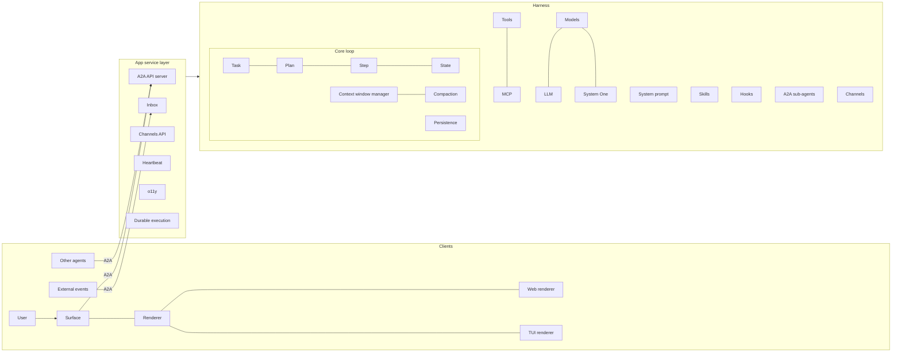
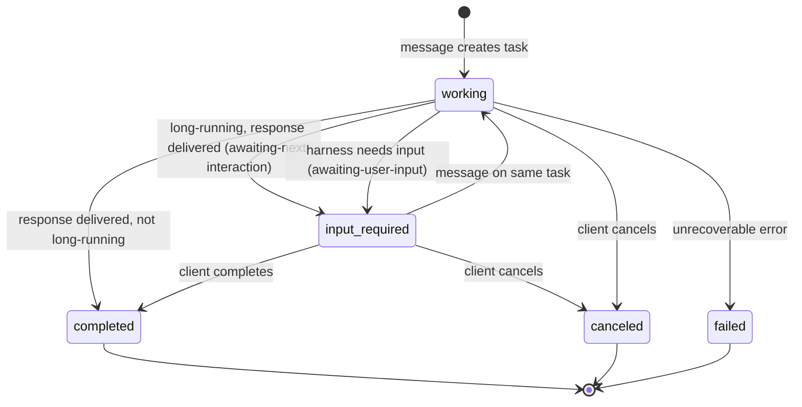

# Requirements: yaah — Yet Another Agent Harness

> Phase 1 of 3 (requirements → design → tasks). Following the Kiro spec approach
> (https://kiro.dev/docs/specs/). This phase MUST be reviewed and approved by the
> required collaborators before moving to design.

## Introduction

The repository holds a toolchain and no product. [Issue #3](https://github.com/MadaraUchiha-314/yaah/issues/3)
asks for the product: an opinionated, production-grade **agent harness** that an
enterprise can deploy for customer-facing workflows, and that is _not_ a coding harness
in disguise — it assumes no file system, no shell and no built-in tools.

This document turns the issue body and its two follow-up comments
([implementation details](https://github.com/MadaraUchiha-314/yaah/issues/3#issuecomment-6881764294),
[definition of done](https://github.com/MadaraUchiha-314/yaah/issues/3#issuecomment-6881803082))
into 27 testable requirements. Three things shape all of them:

- **Everything is a plugin**, composed by [cordis](https://github.com/cordiverse/cordis)
  from a `cordis.yaml`.
- **Everything speaks A2A** (≥ 1.0) — surface to harness, harness to sub-agent, and the
  inbox — through the official SDK, never a hand-rolled client or server.
- **Every entity is a registry entry** addressed by `(id, version)`, local or remote,
  behind one standard interface.

**What it costs.** The issue is epic-sized. To keep the demo reachable, each requirement
carries a priority: **P0** is needed for the definition-of-done demo, **P1** is asked for
in the issue but the demo does not depend on it. Both are in scope; P0 is built and
proved first. If P1 should move to follow-up tickets, say so at this gate
([open question 2](#open-questions)).

**What to check first.** The [open questions](#open-questions) — each states the default
I will proceed on — and [Requirement 14](#requirement-14--task-lifecycle-and-long-running-tasks-p0),
which fixes how a task stays open across turns.

### The system, as the issue draws it

Module and folder boundaries follow this picture (Requirement 26). The fourth column of
the issue's diagram (simulation, evaluation, optimization) is out of scope.

### Priority at a glance

| Area | Requirements | Priority |
| --- | --- | --- |
| Kernel, entities, registry | 1, 2 | P0 |
| Core loop, task/plan, state, context | 3, 4, 5, 6 | P0 |
| LLM providers, MCP tools, system prompt | 7, 8, 10 | P0 |
| Skills, agent plugins, hooks | 9 | P1 |
| Sub-agents, participants, channels | 11, 12 | P0 (11), P1 (12) |
| A2A server, task lifecycle, inbox | 13, 14, 15 | P0 |
| Heartbeat | 16 | P1 |
| Durable execution | 17 | P0 |
| Observability | 18 | P0 (logs, traces), P1 (Langfuse) |
| Surfaces, web, TUI, A2UI | 19, 20, 21 | P0 |
| CLI, SDK, config, commands | 22, 23 | P0 |
| Multi-modal and voice | 24 | P1 |
| Browser build | 25 | P1 |
| Engineering quality, demo | 26, 27 | P0 |

## Requirements

"The harness" is a running yaah instance. "The operator" configures and deploys it. "The
developer" embeds it through the SDK. "The user" talks to it through a surface.

### Requirement 1 — Plugin kernel and composition (P0)

**User story:** As an operator, I want the whole harness described by one `cordis.yaml`,
so that I can replace any part without forking yaah.

#### Acceptance criteria (EARS)

1. WHEN the harness starts THEN the system SHALL build itself by loading a root
   `cordis.yaml` with the `cordis` package, and SHALL NOT depend on any other plugin
   kernel (including the DeepSeek harness).
2. The system SHALL ship one root `cordis.yaml` per build target (at least `cli`,
   `server` and `browser`), each composed from shared, reusable YAML files that hold the
   common capabilities.
3. WHEN an operator's configuration names a plugin for a capability that has a default
   THEN the system SHALL load the operator's plugin in place of the default.
4. IF a plugin named in the composition cannot be loaded THEN the system SHALL fail to
   start and SHALL name the plugin and the cause.
5. WHEN a plugin is disposed THEN the system SHALL remove every registry entry, command,
   hook and route that plugin contributed.

### Requirement 2 — Entity model and registry (P0)

**User story:** As a developer, I want every prompt, skill, tool, model and agent to be
one kind of thing with one address, so that I can swap a local one for a remote one
without changing the caller.

#### Acceptance criteria (EARS)

1. The system SHALL define a documented, typed standard interface for each core entity:
   prompt, skill, tool, LLM, System One model, agent, command, channel, surface and
   renderer.
2. The system SHALL address every entity instance as a registry entry keyed by
   `(id, version)`, where `version` is `null` for an entity kind that is not versioned.
3. WHEN a caller resolves `(id, version)` THEN the system SHALL return the same interface
   whether the entry is local or remote.
4. WHEN an entity is remote THEN the system SHALL reach it only through a declared
   application protocol (A2A for agents, MCP for tools; others named in the design).
5. IF a caller resolves an `(id, version)` that is not registered THEN the system SHALL
   return a typed not-found error and SHALL NOT substitute another version.
6. IF a second entry is registered under an existing `(id, version)` of the same kind
   THEN the system SHALL reject it unless the registration explicitly declares an
   override.

### Requirement 3 — Core loop (P0)

**User story:** As a developer, I want a small, predictable agent loop behind the A2A
agent interface, so that every agent — root, local sub-agent or remote — is invoked the
same way.

#### Acceptance criteria (EARS)

1. The system SHALL expose the agent through one interface whose operations mirror
   [sherma's `Agent`](https://github.com/MadaraUchiha-314/sherma/blob/main/sherma/entities/agent/base.py#L20):
   `sendMessage` (an A2A `Message` in, a stream of A2A `Message`, `Task` and task-update
   events out), `cancelTask`, and `getCard`.
2. WHILE a task is being worked the system SHALL repeat: build the context from state,
   invoke the LLM, extract tool calls, execute them, and append the results — until the
   LLM returns no tool calls.
3. WHEN an LLM response contains more than one tool call THEN the system SHALL execute
   them concurrently and SHALL return every result to the LLM in the order the calls
   were issued.
4. IF one tool call of a concurrent set fails THEN the system SHALL report that failure
   to the LLM as that call's result and SHALL still deliver the results of the others.
5. WHEN `cancelTask` is received for a task in the loop THEN the system SHALL stop
   issuing new LLM and tool calls for it and SHALL move it to `canceled`.
6. IF the loop exceeds its configured iteration limit THEN the system SHALL stop and
   SHALL move the task to `failed` with a reason that names the limit.

### Requirement 4 — Task, plan and step (P0)

**User story:** As a user, I want the harness to organise its work around tasks and
plans I can inspect, so that I can see what it is doing and what it has delegated.

#### Acceptance criteria (EARS)

1. The system SHALL model a task with: name, optional type, goal, description,
   acceptance criteria, `subTasks`, `parentTasks`, and participants each holding one of
   the roles assignee, reporter, watcher or admin.
2. The system SHALL carry that task model on the A2A `Task` (as declared extension
   metadata), not in a parallel task store.
3. WHEN the harness breaks work down THEN the system SHALL record a plan as a directed
   acyclic graph of steps, each with name, description, optional output, and
   `linkedTasks`.
4. IF a plan submitted by the LLM contains a cycle or a dependency on an unknown step
   THEN the system SHALL reject it and SHALL return the reason to the LLM.
5. WHEN a step is executed in an isolated context THEN the system SHALL create a task
   for it, add it to the current task's `subTasks`, set its `parentTasks`, and add it to
   the step's `linkedTasks`.
6. WHEN a task is queried THEN the system SHALL return every sub-task it spawned.

### Requirement 5 — State and persistence (P0)

**User story:** As an operator, I want agent state and plans to survive a restart, so
that a conversation can continue after a deploy.

#### Acceptance criteria (EARS)

1. The system SHALL give each task a state store for arbitrary typed data, readable and
   writable by the agent.
2. WHERE a schema is supplied for part of the state the system SHALL reject a write to
   that part that does not conform.
3. WHEN a task's state or plan changes THEN the system SHALL persist it through the
   persistence interface before acknowledging the change.
4. WHEN the harness restarts THEN the system SHALL restore the state and plan of every
   non-terminal task.
5. The system SHALL allow the persistence backend to be replaced by a plugin, for state
   and for plans independently.

### Requirement 6 — Context window manager and compaction (P0)

**User story:** As an operator, I want the context sent to the LLM to be assembled in a
fixed, cache-friendly order and compacted before it overflows, so that long tasks stay
cheap and do not fail on length.

#### Acceptance criteria (EARS)

1. WHEN the loop invokes the LLM THEN the system SHALL assemble the context from
   templated positions in a fixed order: system prompt, skills, sub-agent and tool
   declarations, task, plan, then conversation.
2. WHILE no entity in a position has changed the system SHALL emit that position
   byte-identical across calls, so that the provider's prompt cache is hit.
3. WHEN the assembled context exceeds a configurable fraction of the model's context
   window THEN the system SHALL compact the conversation before the call.
4. The system SHALL NOT compact the system prompt, the task definition, the current
   plan, or any tool call that has no result yet.
5. WHEN compaction runs THEN the system SHALL emit an event stating the token counts
   before and after.
6. The system SHALL allow the compaction strategy to be replaced by a plugin.

### Requirement 7 — Models: LLM and System One (P0)

**User story:** As an operator, I want to point the harness at any LLM, so that I am not
tied to one provider.

#### Acceptance criteria (EARS)

1. The system SHALL provide LLM entities for OpenAI and for Anthropic, each built on
   that provider's official SDK.
2. The system SHALL provide an LLM entity for any OpenAI-compatible endpoint, configured
   by base URL, model id and credential, so that OpenRouter and Ollama work.
3. The system SHALL expose one provider-agnostic LLM interface covering streaming
   output, tool calls (including several in one response), and image and audio input.
4. IF a provider call fails with a retryable error THEN the system SHALL retry it under
   the configured policy; IF it fails with a non-retryable error THEN the system SHALL
   fail the call with a typed error naming the provider and model.
5. The system SHALL define a System One model interface for fast decisions (a typed
   decision with a confidence), separate from the LLM interface. _(P1: a shipped
   implementation.)_

### Requirement 8 — Tools and MCP (P0)

**User story:** As an operator, I want to register MCP servers as the harness's tools,
so that the agent's abilities come from configuration, not from yaah.

#### Acceptance criteria (EARS)

1. WHEN an MCP server is configured THEN the system SHALL connect with the official MCP
   SDK, list its tools, and register each as a tool entity.
2. The system SHALL register no file-system, shell or network tool unless a plugin or
   the configuration adds one.
3. WHEN a tool is invoked THEN the system SHALL validate the arguments against the
   tool's declared input schema before the call.
4. IF an MCP server is unreachable at start THEN the system SHALL start without its
   tools, SHALL log the failure, and SHALL retry the connection.
5. IF a tool call fails or times out THEN the system SHALL return a typed error result
   to the LLM and SHALL NOT end the task.

### Requirement 9 — Skills, agent plugins and hooks (P1)

**User story:** As an operator, I want to extend the harness with the same plugin and
skill packages other harnesses accept, so that I do not rewrite them for yaah.

#### Acceptance criteria (EARS)

1. WHEN a directory conforming to the [Agent Skills specification](https://agentskills.io/home)
   is configured THEN the system SHALL register each skill, expose its name and
   description to the LLM, and load its body only when the skill is used.
2. WHEN a package conforming to the [Agent Plugins specification](https://agent-plugins.org/)
   is configured — by path or programmatically — THEN the system SHALL register the
   skills, MCP servers, commands and hooks it declares.
3. WHEN a lifecycle point that has hooks is reached THEN the system SHALL run the
   registered hooks in order and SHALL honour a hook's decision to block where the
   specification allows one.
4. IF a skill or plugin package fails validation against its specification THEN the
   system SHALL refuse to load it and SHALL name the violated rule.

### Requirement 10 — System prompt and strings (P0)

**User story:** As an operator, I want every prompt and every user-visible string in a
file I can edit, so that I can tune behaviour and localise the product without touching
code.

#### Acceptance criteria (EARS)

1. The system SHALL ship a minimal default system prompt.
2. The system SHALL store every prompt and prompt fragment sent to an LLM as a markdown
   file, registered as a prompt entity.
3. WHEN an operator registers a prompt under the id of a default prompt, or an
   extension to it, THEN the system SHALL use the override or append the extension.
4. The system SHALL load every user-visible string from one JSON file per locale, and
   source code SHALL contain no user-visible string literal.
5. IF a string key is missing in the active locale THEN the system SHALL fall back to
   the default locale.

### Requirement 11 — Sub-agents over A2A (P0)

**User story:** As a developer, I want the agent to delegate to other agents — yaah or
not — through one interface, so that a local helper and a remote specialist look the
same.

#### Acceptance criteria (EARS)

1. WHEN a sub-agent is declared by agent-card URL THEN the system SHALL fetch its card
   and register it as an agent entity.
2. WHEN the context is built THEN the system SHALL list every registered sub-agent with
   its name, description and skills, and SHALL offer the LLM a tool to invoke one.
3. WHEN the LLM invokes a sub-agent THEN the system SHALL call it through the agent
   interface of Requirement 3 using the official A2A client.
4. WHEN the harness needs context-isolated work THEN the system SHALL invoke a local
   sub-agent with a fresh context window by an A2A call to its own URL (loopback).
5. WHEN any sub-agent is invoked THEN the system SHALL link the resulting task as a
   sub-task of the current task (Requirement 4.5), remote and loopback alike.
6. IF a sub-agent call fails or the sub-task ends `failed`, `canceled` or `rejected`
   THEN the system SHALL return that outcome to the LLM as the tool result.
7. IF loopback delegation would exceed the configured nesting depth THEN the system
   SHALL refuse the call and SHALL return the reason to the LLM.

### Requirement 12 — Participants and channels (P1)

**User story:** As a user, I want the harness to know who is on a task and to ask the
right person the right way, so that a quick question does not become a ticket.

#### Acceptance criteria (EARS)

1. WHEN the context is built THEN the system SHALL include the task's participants and
   the meaning of each role, from an overridable prompt.
2. The system SHALL offer the LLM two distinct tools: one to message a participant on a
   channel for a small input, one to create a task for a participant for work they must
   do.
3. The system SHALL provide a channels API through which the harness sends to and
   receives from participants, and participants send to and receive from the harness.
4. The system SHALL let only the harness add or remove a channel's participants.
5. IF a message arrives on a channel from an identity that is not a participant of that
   channel THEN the system SHALL reject it.

_P0 carries one case of this: the harness asking the user for input on the task's own
conversation (Requirement 14.5)._

### Requirement 13 — A2A API server (P0)

**User story:** As an integrator, I want a standards-compliant A2A endpoint, so that any
A2A client can drive the harness.

#### Acceptance criteria (EARS)

1. The system SHALL serve an A2A ≥ 1.0 API, built on the official A2A SDK, supporting
   every operation of the specification: send message, send streaming message, get
   task, list tasks, cancel task, subscribe to task, the push-notification configuration
   operations, and the agent card.
2. The system SHALL publish an agent card that states its skills, capabilities,
   security schemes and every extension it supports.
3. The system SHALL define every yaah-specific protocol element as an A2A extension
   with a URI and a typed schema, and SHALL advertise it in the agent card.
4. IF a request activates an extension the harness does not support and marks it
   required THEN the system SHALL reject the request with the specification's error.
5. IF a request is malformed THEN the system SHALL reject it with the specification's
   error and SHALL NOT create a task.

### Requirement 14 — Task lifecycle and long-running tasks (P0)

**User story:** As a user, I want to keep talking on the same task after the harness
answers, and to close it myself, so that a conversation is one unit of work.

#### Acceptance criteria (EARS)

1. WHEN a message creates a task without a keep-open indication THEN the system SHALL
   move the task to `completed` once the response is delivered.
2. WHEN the message that creates a task declares it long-running, through yaah's
   task-lifecycle extension, THEN the system SHALL, after each response, hold the task
   in `input-required` with extension metadata stating the sub-state
   `awaiting-next-interaction`.
3. WHILE a task is in `input-required` the system SHALL accept a further message on the
   same task and SHALL continue it with its history and state.
4. The system SHALL define the `input-required` sub-states as an open, versioned
   enumeration in the task-lifecycle extension, so that later sub-states can be added.
5. WHEN the harness needs an input, opinion or judgement call from the user THEN the
   system SHALL move the task to `input-required` with sub-state
   `awaiting-user-input` and a message stating what it needs.
6. WHEN a client requests completion of an open task THEN the system SHALL move it to
   `completed`; WHEN a client requests cancellation THEN the system SHALL move it to
   `canceled`.
7. IF a message targets a task in a terminal state THEN the system SHALL reject it with
   the specification's error.
8. The system SHALL apply the default of criterion 1 to sub-tasks; only the creator of a
   root task can declare it long-running.

_The issue asks what A2A recommends for long-running tasks and whether an extension may
add task states. That research belongs to the design; this requirement fixes the
observable behaviour whichever mechanism it selects._

### Requirement 15 — Inbox and events (P0)

**User story:** As an integrator, I want to hand the harness a message or an event at
any time and know it will not be lost, so that outside systems can inform or interrupt
it.

#### Acceptance criteria (EARS)

1. The system SHALL make the inbox the A2A send-message operation — one endpoint, not a
   second API.
2. WHEN the inbox accepts an item THEN the system SHALL store it durably before
   acknowledging it.
3. The system SHALL accept the four A2A event kinds as inbox input: `Task`, `Message`,
   `TaskStatusUpdateEvent` and `TaskArtifactUpdateEvent`.
4. WHEN an item arrives for a task that is idle THEN the system SHALL process it
   immediately.
5. WHEN an item arrives for a task that is working THEN the system SHALL deliver it at
   the next loop iteration, or interrupt the current iteration if the item is marked as
   an interrupt.
6. WHEN the harness restarts THEN the system SHALL process every stored item that was
   not yet processed, each exactly once from the agent's point of view.

### Requirement 16 — Heartbeat (P1)

**User story:** As an operator, I want the harness to wake on its own and notice what
changed, so that a waiting task does not wait forever.

#### Acceptance criteria (EARS)

1. WHILE the harness runs the system SHALL emit a heartbeat at a configurable interval.
2. WHEN a heartbeat fires THEN the system SHALL check for unprocessed inbox items and
   stalled tasks and SHALL forward what it finds to the agent layer.
3. IF a task has made no progress for longer than a configurable period THEN the system
   SHALL emit an event naming the task.

### Requirement 17 — Durable execution (P0)

**User story:** As an operator, I want a task to survive a crashed process, so that a
customer never loses a conversation or pays twice for the same step.

#### Acceptance criteria (EARS)

1. The system SHALL define a durable-execution interface with three implementations:
   remote Temporal, embedded Temporal, and none (in-process).
2. WHEN durable execution is enabled THEN the system SHALL run each task's core loop as
   a workflow and each LLM call, tool call and sub-agent call as a separately recorded
   step.
3. WHEN a process crashes while a task is working THEN the system SHALL, on recovery,
   resume the task from its last recorded step and SHALL NOT re-invoke an LLM, tool or
   sub-agent call whose result was already recorded.
4. IF a step fails with a retryable error THEN the system SHALL retry it with
   exponential backoff under a configurable policy (initial interval, coefficient,
   maximum interval, maximum attempts).
5. The system SHALL let a tool declare whether it is safe to retry, and SHALL NOT
   automatically retry a tool call that is not, once it may have started.
6. WHEN an A2A request starts or continues a task THEN the system SHALL hand it to the
   durable layer from inside the A2A SDK's agent executor, so that clients observe the
   same A2A behaviour in all three modes.
7. IF remote Temporal is configured and unreachable at start THEN the system SHALL fail
   to start and SHALL NOT fall back to the in-process mode.

_The issue's open questions on Temporal (workflow versus activity boundaries,
non-determinism on replay, pod crashes) are answered in the design; criteria 2–5 are the
guarantees those answers must deliver._

### Requirement 18 — Observability (P0; Langfuse P1)

**User story:** As an operator, I want to reconstruct exactly what happened to a task,
so that I can debug a customer's conversation.

#### Acceptance criteria (EARS)

1. The system SHALL emit a structured log record for every step of a task from request
   receipt to terminal state: request, context build, LLM call, tool call, sub-agent
   call, state change, and status transition — each carrying the task and context ids.
2. The system SHALL emit OpenTelemetry traces with one trace per request and one span
   per step, and SHALL propagate trace context across A2A and MCP calls.
3. The system SHALL use the same logging configuration in development and in
   production.
4. The system SHALL NOT write a credential, an authorization header or a raw API key to
   a log or a span.
5. WHERE Langfuse is configured the system SHALL export LLM calls to it. _(P1)_

### Requirement 19 — Surfaces and renderers (P0)

**User story:** As a user, I want to reach the same harness from a terminal or a
browser and see what the agent produced in the best form each can show.

#### Acceptance criteria (EARS)

1. The system SHALL define a surface interface (how a user reaches the harness, in
   which modalities) and a renderer interface (how messages and artifacts are shown).
2. WHEN a surface talks to the harness THEN the system SHALL use the official A2A
   TypeScript SDK client and no other transport.
3. WHEN two surfaces are attached to one harness instance THEN the system SHALL let
   both read and continue the same task.
4. WHEN the harness emits an [A2UI](https://a2ui.org/) message that uses the default
   catalog THEN each shipped renderer SHALL render it and SHALL return the user's
   interaction to the harness.
5. IF a renderer receives a part or component it cannot render THEN the system SHALL
   show a textual fallback and SHALL NOT fail the conversation.
6. The system SHALL let the agent produce A2UI through a declared A2A extension.

_MCP Apps rendering is a "may" in the issue and is out of scope here._

### Requirement 20 — Web renderer (P0)

**User story:** As a user, I want a clean, minimal chat in my browser.

#### Acceptance criteria (EARS)

1. The system SHALL provide a web chat built with React, [shadcn/ui](https://ui.shadcn.com/)
   and shadcn's AI elements.
2. WHEN the harness streams a response THEN the web renderer SHALL show it
   incrementally.
3. WHILE a task is open the web renderer SHALL show its current state and SHALL offer
   controls to complete and to cancel it.
4. WHEN the harness asks for input THEN the web renderer SHALL make the request
   visually distinct from an ordinary response.
5. WHEN the input matches a registered command THEN the web renderer SHALL highlight
   the command in a distinct colour.
6. The web renderer SHALL meet WCAG 2.1 AA for keyboard operation and contrast.

### Requirement 21 — TUI renderer (P0)

**User story:** As a user, I want the same conversation in my terminal.

#### Acceptance criteria (EARS)

1. The system SHALL provide a terminal UI offering what Requirement 20.2–20.5 offers the
   web: streaming, task state with complete and cancel controls, distinct input
   requests, and command highlighting.
2. WHEN the terminal lacks colour or is not a TTY THEN the TUI SHALL degrade to plain
   line output and SHALL remain usable.
3. WHEN the user issues `/exit` or an interrupt THEN the TUI SHALL restore the terminal
   and exit.

### Requirement 22 — CLI, SDK and configuration (P0)

**User story:** As a developer, I want `yaah` to be both a command I run and a library I
import, with neither a second-class citizen.

#### Acceptance criteria (EARS)

1. WHEN the `yaah` npm package is installed and `yaah` is run with no arguments THEN the
   system SHALL start a harness and open the TUI.
2. The system SHALL provide a command that starts the harness as an A2A server and
   serves the web UI.
3. WHEN the CLI starts and `~/.yaah/config.toml` does not exist THEN the system SHALL
   create it with documented defaults and no secrets.
4. WHEN `--config <path>` is given THEN the system SHALL use that file instead of
   `~/.yaah/config.toml`.
5. IF the configuration file is unreadable or fails validation THEN the system SHALL
   exit non-zero and SHALL name the file, the key and the reason.
6. The system SHALL export from the package every interface, entity and plugin the CLI
   itself uses, so that a developer can build the same harness programmatically.
7. The system SHALL read credentials from environment variables named in the
   configuration, and SHALL NOT require a credential value in the configuration file.

### Requirement 23 — Commands (P0)

**User story:** As a user, I want `/commands` for things that are not conversation.

#### Acceptance criteria (EARS)

1. WHEN the input begins with `/<name>` matching a registered command THEN the system
   SHALL run the command and SHALL NOT send the input to the LLM.
2. The system SHALL ship `/exit`, `/model` (select the LLM) and `/effort` (select the
   reasoning effort).
3. The system SHALL let a plugin register a command as a `(name, function)` pair.
4. WHEN a command runs THEN the system SHALL emit `command.invoked`, then
   `command.executed` or `command.failed`.
5. IF the input begins with `/` and matches no command THEN the system SHALL say so and
   SHALL NOT send it to the LLM.

### Requirement 24 — Multi-modal input, output and voice (P1)

**User story:** As a user, I want to show the agent a picture or just talk to it.

#### Acceptance criteria (EARS)

1. WHEN a message carries an image or audio file part THEN the system SHALL pass it to
   an LLM that accepts that modality, and SHALL otherwise reply that the modality is
   unsupported by the selected model.
2. WHEN the agent produces an image THEN the system SHALL deliver it as an A2A artifact
   and each renderer SHALL show it or link to it.
3. The system SHALL define provider-agnostic speech-to-text and text-to-speech
   interfaces, and SHALL ship OpenAI implementations of both.
4. WHEN the user presses the voice control in the web UI, or holds the configured key
   in the TUI, THEN the system SHALL capture audio and submit it as the user's turn.
5. WHEN voice output is on THEN the system SHALL stream synthesised audio as it is
   produced, not after the full response.
6. IF the microphone is unavailable or permission is denied THEN the system SHALL say
   so and SHALL leave text input working.

### Requirement 25 — Browser build (P1)

**User story:** As a developer, I want to run the whole harness in a browser tab, so
that I can ship an agent with no server of my own.

#### Acceptance criteria (EARS)

1. The system SHALL provide a browser build whose root `cordis.yaml` replaces every
   plugin that needs a non-browser API with a browser-compatible one.
2. WHEN the browser build runs THEN the system SHALL complete a multi-turn task against
   a configured LLM with no yaah server process.
3. IF a plugin that needs a non-browser API is configured into the browser build THEN
   the build SHALL fail and SHALL name the plugin.

### Requirement 26 — Engineering quality (P0)

**User story:** As a maintainer, I want the code to be as strict as the interfaces, so
that a breaking change is caught by a machine.

#### Acceptance criteria (EARS)

1. The system SHALL compile under the strictest TypeScript settings, and source SHALL
   contain no `any`, no untyped record standing in for a model, and no suppressed type
   error.
2. The system SHALL use the official SDK for A2A, MCP, OpenAI, Anthropic and Temporal,
   and SHALL NOT re-implement a protocol one of them provides.
3. The source tree SHALL mirror the architecture diagram: one module per box, grouped
   by the diagram's columns.
4. Every core entity and public interface SHALL carry a doc comment stating its
   purpose, its invariants and its errors.
5. The system SHALL ship unit tests and integration tests that exercise behaviour
   through public interfaces only.
6. The system SHALL ship contract tests for every public interface — the A2A surface,
   each yaah extension, each entity interface, and the configuration schema — that fail
   when the interface changes incompatibly.
7. Every public interface SHALL be specified in `design.md` and approved before it is
   implemented.

### Requirement 27 — Definition-of-done demo (P0)

**User story:** As the product owner, I want to watch one harness do all of this, so
that I can accept the work.

#### Acceptance criteria (EARS)

1. WHEN the demo runs THEN one harness instance SHALL be driven from the TUI and from
   the web UI.
2. WHEN the agent emits A2UI from the default catalog THEN both renderers SHALL render
   it and round-trip an interaction.
3. WHEN the user sends several turns on one long-running task THEN the task SHALL stay
   open until the user completes it.
4. WHEN the agent needs an input or a judgement call THEN it SHALL ask, wait in
   `input-required`, and continue on the reply.
5. The demo SHALL run against Temporal Cloud (namespace `yaah.gtebu`) with OpenAI
   GPT 6.1 as the LLM, with credentials taken from `TEMPORAL_API_KEY` and
   `OPENAI_API_KEY`.
6. Evidence of criteria 1–5 SHALL be committed under `docs/specs/issue-3/evidence/`,
   redacted.

## Non-functional requirements

- **Portability.** The core (kernel, entities, loop, context manager) depends on no
  Node- or Bun-only API, so that Requirement 25 is a composition change, not a rewrite.
- **Responsiveness.** The first streamed token reaches the surface without waiting for
  the full LLM response; a surface never blocks on a tool call to stay interactive.
- **Runtime.** TypeScript, ESM, Bun ≥ 1.4 for development; the published package also
  runs on a current Node LTS.
- **Dependencies.** Each new dependency is justified in `design.md`.
- **Test cost.** Unit and contract tests run with no network and no credential.
  Integration tests that need a live provider are separated and skipped, with a stated
  reason, when the credential is absent.
- **Coverage.** The repository's existing 90 % line and function threshold holds.

## Security considerations

A harness that executes LLM-chosen tool calls on behalf of remote callers is new attack
surface end to end. The rule: **what the model or a remote party says is data; only the
operator's configuration grants capability.**

- **Actors & trust:**
  - _Trusted:_ the operator (configuration, installed plugins, environment).
  - _Untrusted:_ any A2A caller — users, other agents, event sources; LLM output,
    including tool-call arguments, plans and A2UI payloads; MCP server responses and
    tool descriptions; remote agent cards and sub-agent responses; skill and plugin
    package contents until the operator has configured them; uploaded files and audio.
- **Trust boundaries & data:**
  - The A2A API server and inbox: network input becomes tasks and events.
  - LLM output → tool execution and sub-agent invocation.
  - Tool, MCP and sub-agent results → the context window (prompt injection).
  - A2UI payloads → the DOM and the terminal.
  - Plugin loading: third-party code and hooks run in-process.
  - Sensitive data: provider and Temporal API keys, conversation content (may hold
    PII), persisted state, and durable-execution history, which stores payloads outside
    the process.
- **Abuse cases (EARS):**
  1. WHEN an unauthenticated request reaches the A2A API on a non-loopback interface
     THEN the system SHALL reject it.
  2. WHEN a caller reads, continues, completes or cancels a task it does not own THEN
     the system SHALL reject the request without revealing whether the task exists.
  3. WHEN the LLM requests a tool or sub-agent that is not registered for the task THEN
     the system SHALL refuse and SHALL return the refusal as the tool result.
  4. WHEN a tool result, MCP tool description, agent card or sub-agent reply contains
     text styled as instructions THEN the system SHALL present it to the LLM as
     delimited data and SHALL NOT grant any tool, permission or configuration change on
     its account.
  5. WHEN an A2UI payload references a component outside the registered catalog, or
     carries markup or script, THEN the renderer SHALL NOT execute or inject it and
     SHALL show the textual fallback.
  6. WHEN output contains terminal control sequences THEN the TUI SHALL neutralise
     them before display.
  7. WHEN an agent-card or MCP URL supplied at runtime (not by the operator) is to be
     fetched THEN the system SHALL refuse unless the operator's configuration allows
     the host.
  8. WHEN a request exceeds the configured limits on body size, part size, part count
     or tasks per caller THEN the system SHALL reject it before invoking an LLM.
  9. WHEN a sub-agent chain or loopback recursion exceeds the configured depth, or a
     task exceeds its iteration or token budget, THEN the system SHALL stop it.
  10. WHEN an inbox event claims to update a task THEN the system SHALL accept it only
      from the party that task was delegated to.
  11. WHEN a skill or plugin path resolves outside its configured root THEN the system
      SHALL refuse to load it.
  12. WHEN a credential would appear in a log, a trace, an error returned to a caller
      or a prompt THEN the system SHALL redact it.
- **Fail closed:**
  - No authentication configured and a non-loopback bind requested → refuse to start.
  - A credential named in the configuration is absent from the environment → the entity
    that needs it fails to register, and start fails if it is required.
  - Unknown configuration keys, an invalid `cordis.yaml`, or a plugin that fails
    validation → refuse to start.
  - Remote durable execution configured but unreachable → refuse to start
    (Requirement 17.7).
  - A tool with no declared input schema, or arguments that fail it → the call is not
    made.

Authentication and task ownership are not in the issue; they are added here because the
server is otherwise an open relay to the operator's LLM account
([open question 5](#open-questions)).

## Out of scope

- **Self-improvement** — simulation, evaluation, optimization. The issue marks it TBD.
- **Memory** and **Sandbox** — drawn in the diagram, not described in the issue
  ([open question 3](#open-questions)).
- **MCP Apps** rendering, and **video** as a modality — "may" in the issue.
- **A System One implementation backed by a specific model** (the issue's "Jev") — the
  interface ships; see [open question 4](#open-questions).
- **Packages for crates.io or PyPI** — see [open question 1](#open-questions).
- **Multi-tenant administration, billing, user management** and any hosted offering.
- **Custom A2UI catalogs** — only the default catalog.

## Open questions

Each has the default I proceed on if the approval does not say otherwise. Answer on the
pull request.

1. **Language and distribution.** The issue says "crate/pypi/npm"; the repository is
   TypeScript on Bun, and cordis and the named A2A SDK are TypeScript. _Default:_
   TypeScript only, one npm package `yaah`.
2. **Scope of this ticket.** _Default:_ P0 and P1 are both delivered under issue #3, P0
   first, across several pull requests. The alternative is to close #3 on P0 and open
   follow-up tickets for the P1 rows of the [priority table](#priority-at-a-glance).
3. **Memory and Sandbox.** _Default:_ out of scope, no interface reserved.
4. **System One / "Jev".** I do not know what Jev refers to. _Default:_ ship the
   interface only.
5. **Authentication.** _Default:_ loopback-only with no authentication by default;
   a bearer token (from an environment variable, declared in the agent card) is required
   to bind any other interface; a task is owned by the identity that created it.
6. **Model id.** "OpenAI GPT 6.1" — _Default:_ the model id is configuration; tests use
   `gpt-6.1`, confirmed against the provider's model list during design.
7. **Embedded Temporal.** In TypeScript this means a local Temporal development server
   started by the harness, not an in-process engine. _Default:_ accept that; the browser
   build uses the in-process (none) mode.

## Review comments

> Appended by the-loop's `record-feedback` hook when a human gate approves with
> comments (issue-109). Append-only and attributed: an approval never silently
> discards a reviewer's suggestions, and the feedback travels with the document
> it concerns rather than living in a side-channel tracker.
