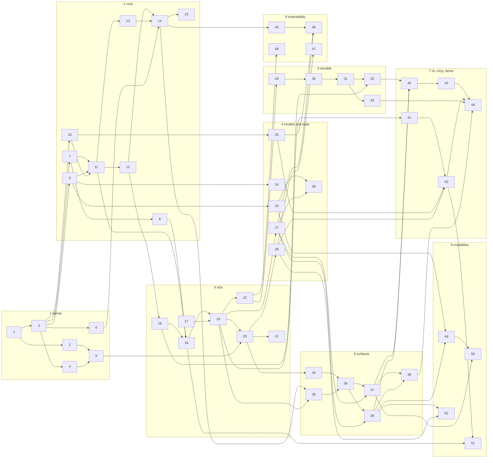

# Tasks: yaah — Yet Another Agent Harness

> The last spec artifact (requirements → design → testing plan → tasks). A DAG of
> implementation tasks derived from the approved [design](design.md) and
> [testing plan](testing-plan.md).

52 tasks in nine slices. Each slice is one pull request, stacked on the one before it;
the stack's base is the spec pull request (#6, branch `issue-3`). Slices 1–7 are P0 and
end with the definition-of-done demo. Slices 8–9 are P1.

| Slice | Branch | Tasks | Delivers |
| --- | --- | --- | --- |
| 1 | `issue-3-1-kernel` | 1–6 | Kernel, registry, config, strings, compositions |
| 2 | `issue-3-2-core` | 7–15 | Stores, scripted LLM, core loop, task/plan/state, context, compaction |
| 3 | `issue-3-3-a2a` | 16–22 | A2A server, extensions, inbox, stream hub, limits |
| 4 | `issue-3-4-models-tools` | 23–28 | LLM providers, MCP tools, sub-agents, commands |
| 5 | `issue-3-5-durable` | 29–33 | In-process journal, Temporal embedded and remote, dashboard |
| 6 | `issue-3-6-surfaces` | 34–39 | Session, A2UI, TUI, web UI |
| 7 | `issue-3-7-cli-o11y-demo` | 40–44 | CLI, logging, tracing, live demo, docs |
| 8 | `issue-3-8-extensibility` | 45–48 | Skills, agent plugins, hooks, channels, heartbeat |
| 9 | `issue-3-9-modalities` | 49–52 | Multi-modal, voice, System One, browser build, Langfuse |

Rules for every task: the test is written first and seen to fail; `bun run check` is
green before the commit; a user-visible string goes in `src/locales/en.json`; a public
interface gets its doc comment and, where it has several implementations, its contract
suite. `T<n>` refers to a row of the testing plan's matrix.

## Task list

### Slice 1 — kernel

- [x] 1. Project layout, dependencies and test scripts
  - Create the `src/` tree of the design (kernel, surface, app, harness, cli,
    compositions, prompts, locales). Add the pinned kernel dependencies. Add scripts
    `test:unit`, `test:integration`, `test:contract`, `test:security`, `test:node` and
    wire `bun run test` to the first four. Add lint rules: no `any`, no type
    suppressions.
  - _Depends on:_ none
  - _Requirements:_ R26.1, R26.3
  - _Test:_ T14 — `bun run check` and `bun run test:node` on an empty suite per directory
- [x] 2. Errors, strings and the redactor
  - `YaahError` hierarchy; `t(key, params)` over `src/locales/<locale>.json` with
    fallback to `en`; `Redactor` (substring and sensitive-key redaction).
  - _Depends on:_ 1
  - _Requirements:_ R10.4, R10.5, R18.4
  - _Test:_ T1, T15 — `test/unit/kernel/strings.test.ts`, `redactor.test.ts` (red→green)
- [x] 3. Entity model and registry
  - `EntityRef`, `Entity`, `Locality`, `Registry` as a cordis service; registration
    inside `ctx.effect`.
  - _Depends on:_ 1
  - _Requirements:_ R2.1–2.6, R1.5
  - _Test:_ T1 — `test/unit/kernel/registry.test.ts`: null version, not-found,
    conflict, override, removal on dispose
- [x] 4. Kernel bootstrap and compositions
  - `kernel/bootstrap.ts` over cordis loader and include; `shared/*.yml`, `cli.yml`,
    `server.yml` with placeholder plugins; `PluginLoadError`.
  - _Depends on:_ 3
  - _Requirements:_ R1.1–1.4
  - _Test:_ T2 — `Scenario: A composition replaces a default plugin by id` ·
    `Scenario: A plugin that fails to load stops start-up and is named` ·
    `Scenario: Disposing a plugin removes its tools and commands`
- [x] 5. Configuration
  - zod schema (`.strict()`), `~/.yaah/config.toml` creation with mode `0600`,
    `--config` precedence, `[[overrides]]` → include patches, generated
    `specs/config/config.schema.json`.
  - _Depends on:_ 2, 4
  - _Requirements:_ R22.3–22.5, R22.7, R1.3
  - _Test:_ T1, T3, T6 — `test/unit/kernel/config.test.ts`; schema equality; default
    file snapshot
- [x] 6. Prompts as entities
  - `Prompt` entity loaded from `src/prompts/*.md`; override and extension; the minimal
    `system.md`, `roles.md`, `untrusted-data.md`.
  - _Depends on:_ 3
  - _Requirements:_ R10.1–10.3
  - _Test:_ T1 — `test/unit/harness/system-prompt.test.ts`

### Slice 2 — core

- [x] 7. Persistence interfaces, memory backend and the contract suite
  - `ConversationStore`, `StateStore`, `PlanStore`, `InboxStore`, `StepJournal`;
    `persistenceContract(factory)` including replace-by-`StepKey`.
  - _Depends on:_ 3
  - _Requirements:_ R5.1, R5.3, R5.5, R15.6
  - _Test:_ T3 — `test/contract/persistence.contract.ts` against the memory backend
- [x] 8. SQLite backend
  - Kysely schema and stores for the five interfaces plus the SDK `DatabaseTaskStore`.
  - _Depends on:_ 7
  - _Requirements:_ R5.3, R5.4
  - _Test:_ T3 — the same contract suite against SQLite on Bun and Node
- [x] 9. LLM interface, contract suite and the scripted LLM
  - `LLM`, `LlmRequest`, `LlmEvent`, `llmContract(factory)`; `ScriptedLlm` that replays
    fixtures from `test/fixtures/llm/`.
  - _Depends on:_ 3
  - _Requirements:_ R7.3
  - _Test:_ T3 — `test/contract/llm.contract.ts` against `ScriptedLlm`
- [x] 10. Tool interface, argument validation and the stub tools
  - `Tool`, `ToolResult`, `toolContract`; `@cfworker/json-schema` validation; a tool
    without a schema is not registered.
  - _Depends on:_ 3
  - _Requirements:_ R8.2, R8.3, R8.5
  - _Test:_ T3, T8 — `tool.contract.ts`; `Scenario: Invalid tool arguments are refused
    before the call`; negative test: tool without a schema
- [x] 11. `StepRunner`, the in-memory runner and `runTask`
  - The loop of the design: wake, accept, iterate, drain, interrupt, cancel, limits.
    A test runner that executes steps directly with no journal.
  - _Depends on:_ 7, 9, 10
  - _Requirements:_ R3.2–3.6, R15.5
  - _Test:_ T2 — `Scenario: Parallel tool calls return in order` · `Scenario: One
    failed tool call does not lose the others` · `Scenario: The iteration limit fails
    the task` · `Scenario: A message during tool execution is read at the next
    iteration` · `Scenario: An interrupting item aborts the current iteration`
- [x] 12. Task model, transitions and `ask_user`
  - `TaskModel` schema; the state table of the task-lifecycle extension as a pure
    function; the suspending `ask_user` path; the task-token budget.
  - _Depends on:_ 11
  - _Requirements:_ R4.1, R4.2, R14.1, R14.2, R14.4, R14.5, R14.8; abuse case 9
  - _Test:_ T1, T8 — `test/unit/harness/core/transitions.test.ts`; negative tests:
    iteration and token limits
- [x] 13. Plan and state tools
  - `plan_set`, `plan_update_step` with DAG validation; `state_get`, `state_set` with
    schema-checked prefixes.
  - _Depends on:_ 11
  - _Requirements:_ R4.3, R4.4, R5.1, R5.2
  - _Test:_ T1 — `plan.test.ts` (cycle, unknown dependency, duplicate), `state.test.ts`
- [x] 14. Context window manager
  - Sections 1–6, hashing and cached rendering, cache boundaries, sanitised
    third-party descriptions, plan snapshot rule.
  - _Depends on:_ 6, 12, 13
  - _Requirements:_ R6.1, R6.2; abuse case 4
  - _Test:_ T1, T6, T8 — byte-stability test; rendered-context snapshot; negative test:
    injected instructions stay inside a result block
- [x] 15. Compaction
  - `CompactionStrategy` service, default strategy, `context.compact` step and event.
  - _Depends on:_ 14
  - _Requirements:_ R6.3–6.6
  - _Test:_ T1 — `compaction.test.ts`: threshold, never-compacted set, turn integrity,
    replaceable strategy

### Slice 3 — A2A

- [ ] 16. Extension schemas and the agent card
  - zod schemas for task-lifecycle, task-model, inbox-events, commands,
    durable-execution; generated JSON Schemas under `specs/a2a-extensions/`; agent card
    builder.
  - _Depends on:_ 12
  - _Requirements:_ R13.2, R13.3
  - _Test:_ T3, T6 — schema equality; agent-card snapshot
- [ ] 17. Stream hub
  - `StreamHub` with a bounded per-task log, replay from a sequence number, `reset`.
  - _Depends on:_ 1
  - _Requirements:_ R17.6, R19.3
  - _Test:_ T1 — `stream-hub.test.ts`: subscribe-before-publish, replay, bound, reset
- [ ] 18. Inbox
  - `inbox.accept`, duplicate detection, the `conversation.accept` step, inbox-event
    parts with the delegation match.
  - _Depends on:_ 8, 11, 16
  - _Requirements:_ R15.1–15.4, R15.6; abuse case 10
  - _Test:_ T2, T8 — `Scenario: A redelivered item is consumed once` · `Scenario: A
    sub-task status event is accepted as inbox input`; negative test: forged event
- [ ] 19. `HarnessExecutor` and the request handler
  - SDK `DefaultRequestHandler` with our executor; subscribe-then-deliver; store
    backstop; `cancelTask`.
  - _Depends on:_ 17, 18
  - _Requirements:_ R3.1, R3.5, R13.1, R14.3, R14.6, R14.7
  - _Test:_ T2 — `Scenario: A response completes a task by default` · `Scenario: A
    long-running task stays open across turns` · `Scenario: The agent asks for input
    and continues on the reply` · `Scenario: A client completes an open task` ·
    `Scenario: A client cancels an idle open task` · `Scenario: A message to a
    completed task is rejected` (the first of these is the recorded red→green)
- [ ] 20. HTTP listener
  - Express 5 with the SDK's JSON-RPC, HTTP+JSON and agent-card handlers; loopback
    default; the `ctx.auth` extension point; unauthenticated-bind notice.
  - _Depends on:_ 19, 5
  - _Requirements:_ R13.1, R13.4, R13.5; abuse case 1
  - _Test:_ T2, T8 — `Scenario: Every A2A operation answers over JSON-RPC and
    HTTP+JSON` · `Scenario: The agent card lists every yaah extension` · `Scenario: A
    required unsupported extension is rejected` · `Scenario: A malformed request
    creates no task`; negative test: default bind
- [ ] 21. Origin check and request limits
  - Origin middleware; body, part and per-caller open-task and rate limits.
  - _Depends on:_ 20
  - _Requirements:_ abuse cases 2, 8
  - _Test:_ T8 — negative tests: foreign origin; oversize; 21st open task; rate
- [ ] 22. Restart recovery in the app layer
  - On start, re-attach non-terminal tasks and re-deliver pending inbox items.
  - _Depends on:_ 19
  - _Requirements:_ R5.4, R15.6
  - _Test:_ T2 — `Scenario: An inbox item survives a restart` · `Scenario: State and
    plan are restored after a restart`

### Slice 4 — models, tools, sub-agents

- [ ] 23. OpenAI provider (Responses)
  - Streaming, parallel tool calls, encrypted reasoning pass-back, cache breakpoints,
    image input, error mapping.
  - _Depends on:_ 9
  - _Requirements:_ R7.1, R7.3, R7.4
  - _Test:_ T3 — `llm.contract.ts` against recorded Responses fixtures; live variant in
    T12
- [ ] 24. Anthropic provider and the OpenAI-compatible provider
  - Messages API with `cache_control`; Chat Completions with `baseURL`.
  - _Depends on:_ 9
  - _Requirements:_ R7.1, R7.2, R7.4
  - _Test:_ T3 — `llm.contract.ts` against recorded fixtures for both; `Scenario: A
    provider error names provider and model`
- [ ] 25. MCP tools
  - `@modelcontextprotocol/client` over stdio and Streamable HTTP; registration;
    `retrySafe` from annotations; reconnect with backoff; the stub MCP server fixture.
  - _Depends on:_ 10
  - _Requirements:_ R8.1, R8.4, R8.5; abuse case 3
  - _Test:_ T2, T8 — `Scenario: MCP tools are registered from a configured server` ·
    `Scenario: An unreachable MCP server does not stop start-up`; negative test:
    unregistered tool
- [ ] 26. Sub-agents over A2A
  - Agent entities from card URLs with the host allowlist; `invoke_agent`; sub-task
    linking; depth limit; `HarnessTarget` and the `self` agent.
  - _Depends on:_ 20
  - _Requirements:_ R4.5, R4.6, R11.1–11.7; abuse cases 7, 9
  - _Test:_ T2, T8 — `Scenario: A sub-agent call links a sub-task` · `Scenario: A
    loopback sub-agent gets a fresh context` · `Scenario: A failed sub-task is reported
    to the model` · `Scenario: Delegation past the depth limit is refused` ·
    `Scenario: A sub-task ignores the long-running request`; negative test: runtime URL
- [ ] 27. Commands
  - `Command` entity, registry service, `/model`, `/effort`, lifecycle events, the
    commands extension in the card.
  - _Depends on:_ 19
  - _Requirements:_ R23.1–23.5
  - _Test:_ T2 — `Scenario: A command never reaches the model` · `Scenario: An unknown
    command is reported`
- [ ] 28. Model selection per context
  - Context settings read by `llm.invoke`; `LlmCapabilities` drives the compaction
    window.
  - _Depends on:_ 23, 27
  - _Requirements:_ R7.3, R23.2
  - _Test:_ T2 — a `/model` turn followed by a turn served by the selected entity

### Slice 5 — durable execution

- [ ] 29. `DurableExecution` interface, contract suite and mode `none`
  - `InProcessRunner` with the retry policy and `StepJournal`; `durableContract`.
  - _Depends on:_ 22
  - _Requirements:_ R17.1, R17.4, R17.5
  - _Test:_ T3, T2 — `durable.contract.ts` (none); `Scenario: A retryable step is
    retried with backoff` · `Scenario: A tool not marked safe is not retried`
- [ ] 30. Temporal workflow and activities
  - `runTask` bundled as a workflow; `TemporalRunner`; activities for each step name;
    signals for inbox delivery; cancellation; continue-as-new; heartbeats.
  - _Depends on:_ 29
  - _Requirements:_ R17.2, R17.3, R17.6
  - _Test:_ T3 — `durable.contract.ts` against embedded Temporal
- [ ] 31. Embedded and remote modes
  - `createLocal` with UI, fixed loopback ports and a database file; remote connection
    with API key; fail-closed start; optional payload codec.
  - _Depends on:_ 30
  - _Requirements:_ R17.1, R17.7, R17.9
  - _Test:_ T2, T8 — `Scenario: Embedded mode serves the Temporal Web UI` · `Scenario:
    Unreachable remote Temporal stops start-up`
- [ ] 32. Dashboard address and task links
  - `dashboard()`, `taskUrl()`; start-up output; durable-execution extension in the
    card and on tasks.
  - _Depends on:_ 31, 16
  - _Requirements:_ R17.8, R17.10
  - _Test:_ T2 — `Scenario: The Temporal Web UI address is printed and in the agent
    card` · `Scenario: A task carries a link to its workflow`
- [ ] 33. Crash recovery
  - `test:chaos`: a child-process harness killed with `SIGKILL` mid-tool and
    mid-LLM-call, restarted, with stub tools that count calls.
  - _Depends on:_ 31
  - _Requirements:_ R15.6, R17.3–17.5
  - _Test:_ T13 — `Scenario: A crashed run resumes without repeating a recorded step`
    (in-process, embedded)

### Slice 6 — surfaces

- [ ] 34. `HarnessSession` and `TaskView`
  - SDK client wrapper; extension activation; `follow` as snapshot-then-subscribe.
  - _Depends on:_ 20
  - _Requirements:_ R19.1–19.3
  - _Test:_ T2 — `Scenario: Two surfaces follow one task`
- [ ] 35. A2UI on the agent side
  - `@a2ui/agent` prompt snippet and parsing; A2UI data parts; user actions as
    conversation events; the official A2UI extension in the card.
  - _Depends on:_ 14, 19
  - _Requirements:_ R19.4, R19.6; abuse case 5
  - _Test:_ T2, T8 — `Scenario: A basic-catalog A2UI form round-trips an action`;
    negative test: unknown component and `javascript:` URL
- [ ] 36. Renderer interface, contract suite and the headless A2UI model
  - `Renderer`, `rendererContract`; `MessageProcessor` wiring shared by both UIs;
    textual fallback.
  - _Depends on:_ 34, 35
  - _Requirements:_ R19.1, R19.5
  - _Test:_ T3, T2 — `renderer.contract.ts`; `Scenario: An unknown A2UI component falls
    back to text`
- [ ] 37. TUI
  - Ink app per `design/tui.html`: transcript, streaming, tool groups, input request,
    status line, complete and cancel keys, command highlight, the basic-catalog
    terminal renderer, the output filter, the non-TTY path.
  - _Depends on:_ 36, 27
  - _Requirements:_ R21.1–21.3, R19.4; abuse case 6
  - _Test:_ T4, T6, T8 — `test/e2e/tui.test.ts` over a pseudo-terminal; frame
    snapshots; negative test: terminal escapes
- [ ] 38. Web UI
  - Vite, React, Tailwind, shadcn AI Elements patterns per `design/web-chat.html`;
    `A2uiSurface` with the themed basic catalog; task controls; Temporal link; served
    by the HTTP listener.
  - _Depends on:_ 36, 27
  - _Requirements:_ R20.1–20.5, R19.4
  - _Test:_ T4 — `test/e2e/web.spec.ts` (Playwright): send, stream, form, input
    request, complete, cancel, command highlight
- [ ] 39. Visual and accessibility pass
  - Screenshots per state and theme against the prototypes; axe; keyboard-only flow.
  - _Depends on:_ 37, 38
  - _Requirements:_ R20.6, R21.2
  - _Test:_ T5, T9 — `bun run test:e2e -- --update-evidence`; `--grep @a11y`

### Slice 7 — CLI, observability, demo

- [ ] 40. CLI and package exports
  - `yaah`, `yaah serve`, `yaah tui --url`, `--config`; `createHarness`; subpath
    exports; `specs/api/exports.json`; package name `@yaah/yaah`.
  - _Depends on:_ 37, 38, 32
  - _Requirements:_ R22.1, R22.2, R22.6
  - _Test:_ T3, T4 — export-list equality; e2e starts from the built package
- [ ] 41. Logging
  - `Logger` service, the fixed record types, redaction at the four exits.
  - _Depends on:_ 19
  - _Requirements:_ R18.1, R18.3, R18.4; abuse case 12
  - _Test:_ T2, T8 — `Scenario: Every step of a task is logged with task and trace
    ids`; negative test: credential leak
- [ ] 42. Tracing
  - OpenTelemetry spans by the GenAI conventions; OTLP exporter; `traceparent` across
    A2A and MCP.
  - _Depends on:_ 41, 25, 26
  - _Requirements:_ R18.2
  - _Test:_ T2 — `Scenario: One trace spans the A2A call, the model call and the tool
    call`
- [ ] 43. Fail-closed start-up and security sweep
  - Missing credential, invalid composition, plugin validation; path containment
    helpers; run the whole T8 suite.
  - _Depends on:_ 40
  - _Requirements:_ Security considerations — fail closed; abuse case 11
  - _Test:_ T8 — `bun run test:security` (all twelve abuse cases and the fail-closed
    list)
- [ ] 44. Live suite, demo and documentation
  - `test:live`, `demo:up`, `demo:record`, `demo:down`; the chaos test against
    Temporal Cloud; README, `docs/architecture/`, `docs/capabilities/`,
    `docs/decisions/` for the ten design decisions.
  - _Depends on:_ 33, 39, 42, 43
  - _Requirements:_ R27.1–27.7, R26.2, R26.4–26.7
  - _Test:_ T12, T13, T11 — the demo script; `test:chaos` remote; exploratory session

### Slice 8 — extensibility (P1)

- [ ] 45. Skills
  - Parser and validator for the Agent Skills specification; `load_skill`,
    `read_skill_file`; path containment.
  - _Depends on:_ 14
  - _Requirements:_ R9.1, R9.4; abuse case 11
  - _Test:_ T2, T8 — `Scenario: A skill body is loaded only when used`; negative test:
    path escape
- [ ] 46. Agent plugins and hooks
  - `plugin.json` and `mcp.json` with the vendored schemas; the hooks service;
    MCP-tool hooks and prompt commands from the client-extension directory.
  - _Depends on:_ 45, 25, 27
  - _Requirements:_ R9.2–9.4
  - _Test:_ T2 — `Scenario: An agent plugin registers its skills and MCP servers` ·
    `Scenario: A hook denies a tool call`; the conformance fixtures of the specification
- [ ] 47. Participants and channels
  - `Channel` entity, `ChannelManager`, the channels extension,
    `message_participant`, `create_task_for_participant`, the roles prompt.
  - _Depends on:_ 26
  - _Requirements:_ R12.1–12.5
  - _Test:_ T2 — `Scenario: A message from a non-participant is rejected`; a small-input
    round trip; a task created for a participant
- [ ] 48. Heartbeat
  - Timer plugin, pending-item re-delivery, `task.stalled`.
  - _Depends on:_ 22
  - _Requirements:_ R16.1–16.3
  - _Test:_ T2 — `Scenario: The heartbeat reports a stalled task`

### Slice 9 — modalities and builds (P1)

- [ ] 49. Multi-modal input and image output
  - Image and audio parts through to the model or a clear refusal; `generate_image`;
    image artifacts in both renderers.
  - _Depends on:_ 23, 38
  - _Requirements:_ R24.1, R24.2
  - _Test:_ T2, T4 — an image turn; an unsupported-modality reply; an image artifact
    rendered
- [ ] 50. Speech and voice
  - `SpeechToText`, `TextToSpeech` and OpenAI implementations; the voice extension;
    microphone button in the web UI; hold-to-talk with a toggle fallback in the TUI;
    streamed audio playback.
  - _Depends on:_ 49, 37
  - _Requirements:_ R24.3–24.6
  - _Test:_ T2, T4 — `Scenario: An audio turn is transcribed for a text-only model`;
    audio chunks arrive before the final event; microphone-denied path
- [ ] 51. System One and Langfuse
  - `SystemOne` interface, contract suite, the OpenAI Decisions implementation, the
    opt-in inbox triage; the Langfuse exporter preset.
  - _Depends on:_ 18, 42
  - _Requirements:_ R7.5, R7.6, R18.5
  - _Test:_ T3, T2 — `systemOne.contract.ts`; triage on and off; exporter headers
- [ ] 52. Browser build
  - `browser.yml`, `build:browser`, the in-memory SDK transport, the node-only plugin
    check; update the P1 documentation.
  - _Depends on:_ 38, 26
  - _Requirements:_ R25.1–25.3
  - _Test:_ T2, T4 — `Scenario: The browser build completes a multi-turn task without
    a server`; a build that includes a node-only plugin fails by name

## Dependency graph (DAG)

Slices are sequential as pull requests; inside a slice, tasks with no path between them
can be done in either order.

## Checkpoints

- **After every task:** its named test red, then green; `bun run check`; one commit;
  the box ticked.
- **End of each slice:** `bun run test` and `bun run test:node`; the slice's pull
  request opened on the branch named above, based on the previous slice's branch, and
  recorded against issue #3; CI green before the next slice starts.
- **End of slice 5:** `bun run test:chaos` in-process and embedded.
- **End of slice 6:** `bun run test:e2e`, with screenshots compared to `design/`.
- **End of slice 7:** the live suite and the demo — the P0 definition of done. If a
  credential or Temporal Cloud is unavailable, that is escalated on the pull request
  and slices 8–9 continue meanwhile.
- **After task 52:** the `verification` node executes `testing-plan.md` in full, then
  the review phases and the security review gate run.

## Review comments

> Appended by the-loop's `record-feedback` hook when a human gate approves with
> comments (issue-109). Append-only and attributed: an approval never silently
> discards a reviewer's suggestions, and the feedback travels with the document
> it concerns rather than living in a side-channel tracker.
